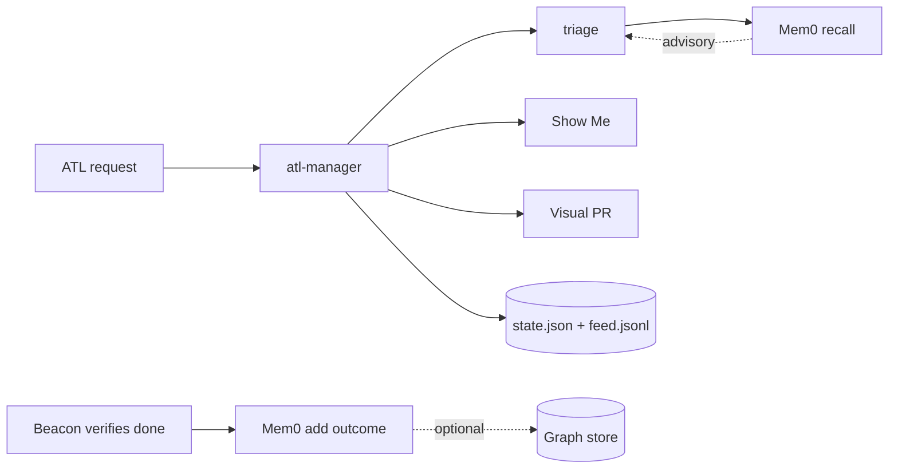
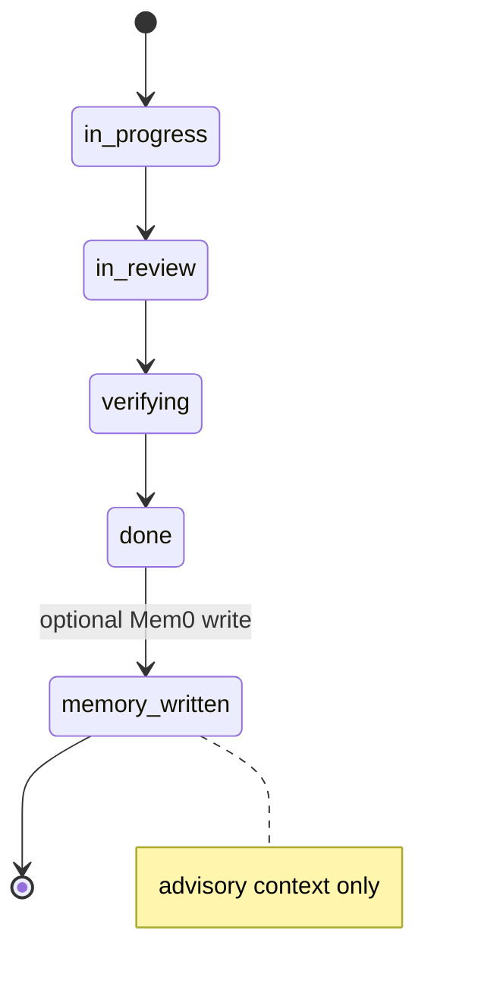

<!-- Generated by ATL visual-pr from inspected repository output. Branch: feat/content-quality-team-workflow -->

## Why the change

ATL adds a bounded content-quality and team-handoff workflow so reviewers can see the change shape and verify its evidence before trusting it.

## Special things to note

- Mem0 graph memory is not enabled by default and does not replace ATL's authoritative state or audit feed.
- The generated outline is a reviewer aid; runtime checks remain the source of behavioral proof.

## Change outline

### What this PR adds

- **Content quality team** — adds a bounded intake, rubric, readability/SEO checks, and a delivery handoff for content changes.
- **Team routing** — makes role selection, triage, independent review, and evidence-gated completion visible through the manager workflow.
- **Show Me** — emits a structural handoff with capability map, architecture, control flow, and evidence snapshot for human review.
- **Visual PR** — generates this description from the inspected diff, including a grouped file map, architecture diagram, and task-state boundary.
- **Optional graph memory** — recalls advisory context during triage and records verified outcomes after completion; Mem0 is opt-in and never authoritative.

### Changed responsibilities

```markdown
| Area | Files |
| --- | --- |
| Project surface | `README.md` |
| Configuration | `config/manager.json`, `config/model-routing.json` |
| Docs | `docs/skills.html`, `docs/team-playbook.md`, `docs/team.html` |
| Runtime | `runtime/README.md`, `runtime/atl-manager.mjs`, `runtime/lib/memory.mjs`, `runtime/lib/roles.mjs`, `runtime/lib/show-me.mjs`, `runtime/lib/visual-pr.mjs`, `runtime/prompts/beacon.md`, `runtime/prompts/rowan.md` |
| Skills | `skills/atl-content-quality/SKILL.md`, `skills/atl-content-quality/agents/openai.yaml`, `skills/atl-content-quality/references/checklist.md`, `skills/atl-content-quality/references/copy-quality.md`, `skills/atl-team/SKILL.md`, `skills/atl/SKILL.md`, `skills/atl/references/routing.md`, `skills/atl/references/skill-catalog.md` |
```

### Architecture view



### Task-state boundary



### Show Me artifact

The generated structural handoff is saved beside this description as `show-me.md`; it is a review aid, not behavioral proof.

Title: feat(atl): add visual handoffs and optional graph memory
