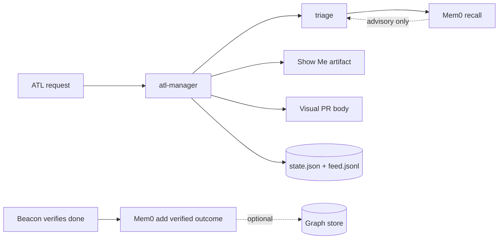

# Show Me

Branch: `feat/content-quality-team-workflow`
Task: No task id supplied.

## Change shape

```text
.
├── .humanlayer
│   └── tasks
│       ├── pr-content-quality-team
│       │   └── description.md
│       └── pr-feat-content-quality-team-workflow
│           ├── description.md
│           └── show-me.md
├── README.md
├── config
│   ├── manager.json
│   └── model-routing.json
├── docs
│   ├── skills.html
│   ├── team-playbook.md
│   └── team.html
├── runtime
│   ├── README.md
│   ├── atl-manager.mjs
│   ├── lib
│   │   ├── memory.mjs
│   │   ├── roles.mjs
│   │   ├── show-me.mjs
│   │   └── visual-pr.mjs
│   └── prompts
│       ├── beacon.md
│       └── rowan.md
└── skills
    ├── atl
    │   ├── SKILL.md
    │   └── references
    │       ├── routing.md
    │       └── skill-catalog.md
    ├── atl-content-quality
    │   ├── SKILL.md
    │   ├── agents
    │   │   └── openai.yaml
    │   └── references
    │       ├── checklist.md
    │       └── copy-quality.md
    └── atl-team
        └── SKILL.md
```

## Capability map

- **Content quality** — `skills/atl-content-quality`: SEO audits, factual copy, and explicit unknowns
- **Team routing** — `runtime/atl-manager.mjs + skills/atl-team`: Pip → Rowan → Sage → Beacon ownership and evidence gates
- **Show Me** — `runtime/lib/show-me.mjs`: Structural handoff with file tree, flow, and repository snapshot
- **Visual PR** — `runtime/lib/visual-pr.mjs`: Reviewer-ready PR body with visual architecture views
- **Graph memory** — `runtime/lib/memory.mjs`: Optional Mem0 recall and verified-outcome writes

## Architecture



## Control flow

```text
ATL request
  route through the selected specialist
  record state and evidence in the local runner
  render a structural handoff for review
  verify the same acceptance checks before close-out
```

## Evidence snapshot

```text
## feat/content-quality-team-workflow...origin/feat/content-quality-team-workflow
 M .humanlayer/tasks/pr-feat-content-quality-team-workflow/description.md
 M .humanlayer/tasks/pr-feat-content-quality-team-workflow/show-me.md
 M runtime/lib/show-me.mjs
 M runtime/lib/visual-pr.mjs

.../tasks/pr-content-quality-team/description.md   |  69 ++++++++++++
 .../description.md                                 |  58 +++++++++++
 .../show-me.md                                     |  96 +++++++++++++++++
 README.md                                          |   1 +
 config/manager.json                                |  15 +++
 config/model-routing.json                          |   5 +
 docs/skills.html                                   |   1 +
 docs/team-playbook.md                              |   7 +-
 docs/team.html                                     |   2 +-
 runtime/README.md                                  |   2 +
 runtime/atl-manager.mjs                            |  77 +++++++++++++-
 runtime/lib/memory.mjs                             | 114 ++++++++++++++++++++
 runtime/lib/roles.mjs                              |  14 ++-
 runtime/lib/show-me.mjs                            | 116 +++++++++++++++++++++
 runtime/lib/visual-pr.mjs                          |  75 +++++++++++++
 runtime/prompts/beacon.md                          |   3 +-
 runtime/prompts/rowan.md                           |   4 +-
 skills/atl-content-quality/SKILL.md                |  87 ++++++++++++++++
 skills/atl-content-quality/agents/openai.yaml      |   4 +
 skills/atl-content-quality/references/checklist.md |  34 ++++++
 .../atl-content-quality/references/copy-quality.md |  11 ++
 skills/atl-team/SKILL.md                           |   9 +-
 skills/atl/SKILL.md                                |   1 +
 skills/atl/references/routing.md                   |   1 +
 skills/atl/references/skill-catalog.md             |   1 +
 25 files changed, 799 insertions(+), 8 deletions(-)
```

Generated from inspected repository output. This outline is a communication aid, not proof of behavior.
