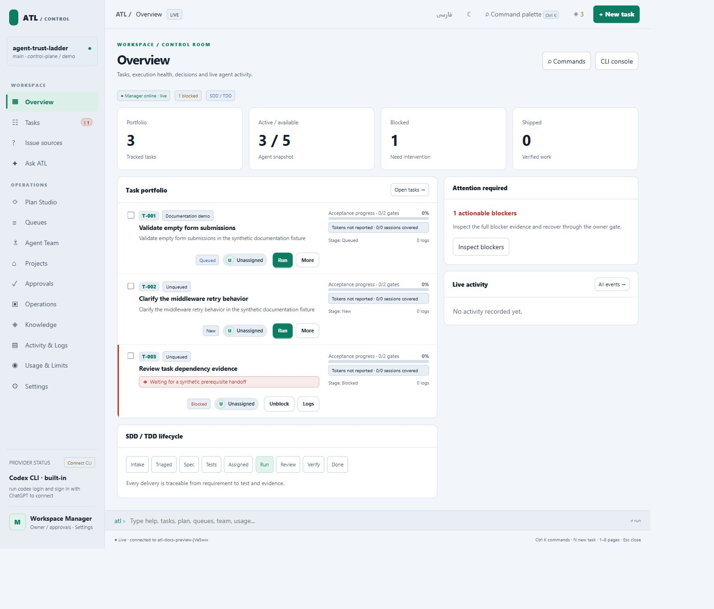

# Agent Trust Ladder

Evidence-gated engineering skills and a local Control Plane for tasks, queues, agent teams, and bounded execution.

[Documentation website](https://depie99.github.io/Agent-Trust-Ladder/) · [Getting started](docs/getting-started.md) · [Feature map](docs/guides.md) · [فارسی](README.fa.md)

## Start a project

Use Node.js 22+ and Git. Install the runtime from a clone:

```powershell
git clone https://github.com/depie99/Agent-Trust-Ladder.git
cd Agent-Trust-Ladder
npm ci
scripts\install-atl.cmd
```

On macOS/Linux use `sh scripts/install-atl.sh`. Open a new terminal, then initialize the application you want ATL to manage:

```sh
cd path/to/your-application
atl init
atl ui --port 4317
```

Open the printed loopback URL. Install skills separately with `npx skills add depie99/Agent-Trust-Ladder --all`, restart your agent, and invoke `$atl` with the problem.



## Find a workflow

| Goal | Guide |
|---|---|
| Connect Jira, GitHub, or Azure Boards | [Issue sources](docs/issue-sources.md) |
| Convert a description into reviewed tasks | [Plan Studio](docs/plan-studio.md) |
| Manage tasks and named queues | [Tasks and queues](docs/tasks-and-queues.md) |
| Run bounded unattended work | [Overnight runs](docs/overnight-runs.md) |
| Ask questions or authorize a fix | [Ask ATL](docs/ask-atl.md) |
| Inspect changes and evidence | [Change review](docs/task-change-review.md) |
| Choose models and manage allowances | [Resource policy](docs/resource-policy.md) |
| Understand learning and usage | [Knowledge](docs/brain.md), [reports](docs/execution-reports.md) |
| Find resources and implementation | [Resource model](docs/resource-model.md), [file catalog](docs/repository-map.md) |

Provider execution needs a ready configured provider. A completed session does not alone prove a fix, publish a PR, or deploy an application. Inspect current checks and independent review before delivery.

## Develop and verify

```sh
npm ci
npm run docs:build
npm run docs:check
npm run docs:serve
```

See [development](docs/development.md), [documentation maintenance](docs/documentation.md), and [verification](verification/README.md). HTML and search are generated from Markdown sources in `docs/site.json`.

## Repository map

`runtime/` executes work; `config/` defines policy; `skills/` contains agent contracts; `commands/` exposes agent entry points; `verification/` contains checks; `docs/` contains guides and the website; `research/` preserves reviewed proposals. Local execution records belong to the managed project's `.trust/manager/`.

Licensed under [MIT](LICENSE).
