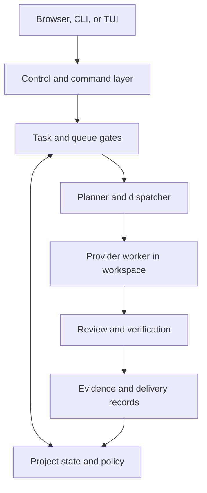

# Architecture

ATL combines declarative engineering skills with a local stateful runtime. Skills guide decisions; the runtime validates persisted work, dispatches bounded sessions, and records evidence.

## Trace a request

| Boundary | Main source | Purpose |
|---|---|---|
| Commands | `runtime/atl-manager.mjs`, `command-console.mjs` | Parse operator actions |
| Browser projection/API | `control-plane.mjs`, `control-plane-server.mjs` | Present state and validate owner requests |
| Intake/composition | `intake.mjs`, `composer.mjs` | Preserve source identity and create candidates |
| Planning | `plan-studio.mjs`, `plan-model.mjs` | Ground decomposition and bind review |
| Coordination | `launch.mjs`, `dispatcher.mjs`, `supervisor-runner.mjs` | Apply resource and concurrency gates |
| Execution/recovery | `worker.mjs`, `queue-recovery.mjs`, `handoffs.mjs` | Bound work and carry artifacts |
| Evidence | `state.mjs`, `governance.mjs`, `task-diagnostics.mjs` | Tie lifecycle decisions to current checks |
| Learning | `brain.mjs`, `memory.mjs`, `resource-policy.mjs` | Retain source-backed context and calibration |

Module names are under `runtime/lib/` unless a full path is shown. The [file catalog](repository-map.md) inventories maintained files.

## Understand ownership

Project state lives under the managed application’s `.trust/manager/`; project policy lives under `config/`. Providers and registered projects also have user-scoped storage. Check the target directory and any project override before acting.

`state.json` is the task store, not the whole system. Queues, approvals, ledgers, plans, conversations, handoffs, captures, and Brain sources have separate records. See the [resource model](resource-model.md).

## How to inspect a feature

Start from its [guide](guides.md), follow the source module, inspect its verifier, and reproduce behavior against a synthetic project. Read the state contract before changing transitions. A skill instruction does not prove a runtime gate ran, and a local pass does not establish remote deployment.
