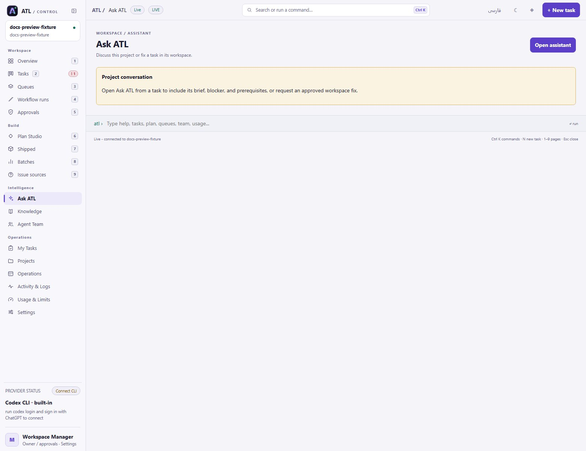
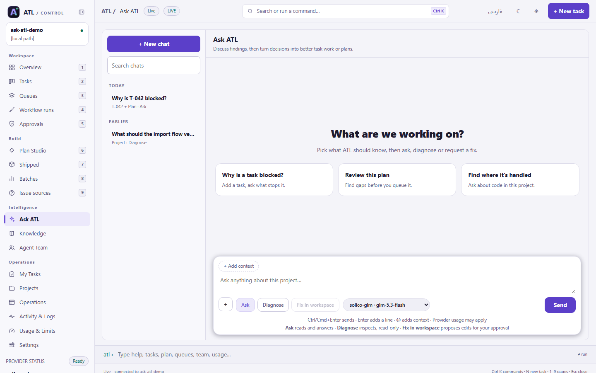
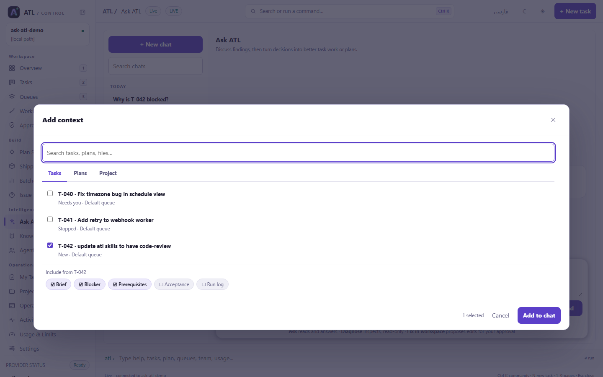
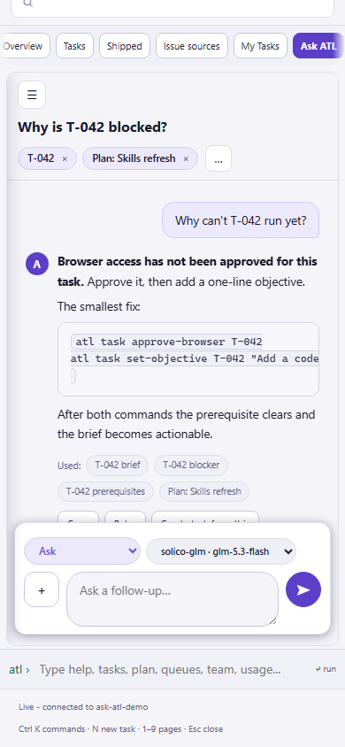

# Ask ATL conversations and workspace access

Ask ATL is the Control Plane's conversation page: a project chat with its own context, a mode, and a provider. It discusses recorded state, diagnoses blockers, and can propose workspace fixes — without bypassing approvals, independent review, or evidence gates.



## Open a conversation

1. Open **Ask ATL** under Intelligence in the Control Plane navigation.
2. Start a new chat, or pick a past conversation from the rail. The rail groups conversations into **Today** and **Earlier** and filters as you type.
3. From a task, choose **Ask ATL** in its details (or **Fix in Ask ATL** on a blocked agent pod). ATL reopens that task's existing single-task conversation, or seeds a new chat with the task attached in Diagnose mode.

A new chat opens on the landing view: a heading, three starting points (blocked task, plan review, project code), and the composer. On narrow screens the chat rail becomes a drawer behind the hamburger button, the mode and provider controls collapse into dropdown pills, and the composer becomes a pill input with a circular send button.



## Pick the context

The context tells the provider what to read before it answers. Choose **+ Add context** (or the square **+** button, or type **@** in the composer) to open the picker:

- **Tasks** — imported tasks only (GitHub, Azure DevOps, Jira sources). Native tasks stay out; import issues from an issue source first. Each row shows the task, its status, and its queue.
- **Plans** — saved Plan Studio drafts.
- **Project** — the manager queue digest and suggested focus.

For each selected task, choose what to include: **Brief**, **Blocker**, **Prerequisites** (the default three), **Acceptance**, and **Run log**. A conversation carries at most six tasks, three plans, and the project digest. **Add to chat** attaches the selection; the resulting chips can be removed individually, and reopening the picker on an existing conversation edits its stored context in place.

Every send records what the reply actually used: the **Used:** chips under a reply name the includes and plans that reached the provider prompt.



## Choose a mode and a provider

- **Ask** reads the context and answers.
- **Diagnose** inspects recorded state, read-only.
- **Fix in workspace** asks a CLI provider to edit one task's isolated workspace. It stays disabled until the conversation has exactly one task with a workspace, and it requires a CLI provider (Codex CLI or GapCode). OpenAI-compatible HTTP providers answer Ask and Diagnose questions only.

The provider pill merges the built-in CLI adapters with any OpenAI-compatible HTTP providers registered in the user provider registry (`providers.json` under the ATL home directory). Not-ready providers are listed with their reason and cannot be selected. Provider usage may apply; the first assistant request on a fresh project also needs a one-time owner approval.

The composer sends with Ctrl/Cmd+Enter; Enter adds a line. Message drafts, mode, and provider choice survive navigation and background refreshes.

## Read replies and act

Replies render paragraphs, lists, emphasis, and code without executing message HTML. Each reply offers **Copy**, **Retry**, **Create task from this**, and **Save to Knowledge** — the last stores the reply as an unverified claim owned by `ask-atl`; approve it on the Knowledge page after checking it.

A finished fix shows the **Proposed fix** card with a **Needs approval** badge. Nothing is accepted until you review the changes, and the result is still reviewed independently. A failed request shows its failure category with **Prepare retry**.

Conversations are stored per project under `.trust/manager/assistant/conversations/`. Legacy per-scope transcripts from before the page redesign migrate once and appear in the rail. Rename or delete a conversation from its **…** menu; deletion removes the local chat only — task state and evidence are untouched.



## Recover from an access failure

1. In the conversation, choose **Fix workspace access**, or open **Workspace access** from the task's details.
2. Select **Read, edit and run commands in the task workspace**, then choose **Apply task access**. Select **Use project default** to remove an override.
3. Choose **Check workspace access**. On Windows this runs a local sandbox command which creates, reads and removes a unique temporary file in the task workspace. It uses no model session and no task-session budget.
4. Return to the conversation and choose **Prepare retry**. Inspect the message and use **Send message** to review the normal approval request. Saving access and checking access do not automatically retry the failed provider request.

For a shared default, use **Settings → Workspace access → Default workspace access → Save access default**. This project setting applies to all models of the built-in GapCode and Codex CLI adapters, for Ask ATL and queue workers. Task overrides take precedence. Diagnose conversations remain read-only. Custom CLI adapters retain their own contracts; no machine-wide GapCode/Codex configuration is changed.

Settings are stored in `config/manager.json`:

```json
{
  "execution_access": {
    "default": "workspace-write",
    "tasks": { "T-022": "workspace-write" }
  }
}
```

Only `read-only` and `workspace-write` are accepted. An absent setting retains the existing workspace-write default. Changes affect future runs and preserve task budgets, evidence, repair allowances and independent review gates. Browser mutations require the same owner session and CSRF protection as other Control Plane operations.

## What the check proves

Both built-in launch paths — queue workers and Ask ATL fixes — share one permission adapter and receive the matching named permission profile on Windows (`:workspace` or `:read-only`); non-Windows invocations keep the sandbox-mode flags. Before a real provider-backed fix, ATL runs the local read/write/remove sandbox probe before charging a model session, and a failed probe returns its exact diagnostic. If a provider nevertheless starts read-only, ATL stops it immediately and preserves that failure category.

A successful local check proves sandbox filesystem access only. It does not grant approval to external MCP tools, override managed policy, verify a model's commands, approve work, or complete a task. If filesystem access passes but a model's MCP tool still needs approval, inspect that tool's configuration and approval mechanism — the interface distinguishes this tool-policy failure from a provider account or model error. A zero exit with denied access is a failed fix, not work ready for review.

Dependency readiness is separate: a task with dependencies needs its locked installation and matching `.atl-dependencies.json` receipt. Set `workspaces.provisionLocal: true` to authorize an automatic offline `npm ci` with scripts disabled, using the project-local npm cache. Neither readiness nor unblocking proves an acceptance check or review passed.

## Browser tools for rendered checks

Tasks whose objective, checks, or skills require rendered inspection receive the `atl_browser` MCP server in worker sessions, and task-scoped Ask ATL **Fix** uses the same tools. Diagnose remains read-only and does not start a browser. Custom provider commands remain responsible for their own browser tooling; the runtime does not inject an incompatible MCP configuration into them or waive their evidence gates.

If the host rejects a call because its approval policy is `never`, use **Task details → Browser access → Allow ATL test browser → Apply browser access**. The failure panel's **Fix browser access** button opens this control directly. For a shared default, use **Settings → Browser access → Save browser default**; each task can use the project default, require approval, or allow the ATL test browser, and a task restriction takes precedence over an allowed project default. **Check browser runtime** starts and closes a disposable test browser without spending a model session or task budget — it verifies the runtime, not effective model-tool approval.

The UI stores only this isolated-browser policy in `config/manager.json`:

```json
{
  "ui_review": {
    "browser_access": {
      "default": "approval-required",
      "tasks": { "T-022": "approved" }
    }
  }
}
```

The model drives `browser_preview`, `browser_snapshot`, `browser_action`, `browser_inspect`, `browser_screenshot`, `browser_viewport`, and `browser_reload` against an isolated Playwright browser with disposable fixture state; it never uses your browser profile, and navigation is restricted to the fixture origin with GET/HEAD. Capture receipts deliberately say **NOT OBSERVED** — the model must examine the image and submit its exact check through the scoped `observe` command; capturing an image never completes a task or replaces independent review.

## Verification

- `node verification/ask_atl_conversations_test.mjs` — conversation storage and migration, context normalization and caps, HTTP provider sends with used-context labels, fix gating, rename/delete, save-to-Knowledge.
- `node verification/control_plane_modal_test.mjs` — desktop and narrow-screen page layout, rail drawer, context picker, mode controls, composer fit.
- `node verification/execution_access_test.mjs` and `node verification/browser_access_test.mjs` — access defaults, overrides, and owner/CSRF enforcement.

The redesign screenshots in `docs/diagrams/ask-atl-redesign.after.*.png` were captured from a synthetic project with stub providers; no real provider ran.
