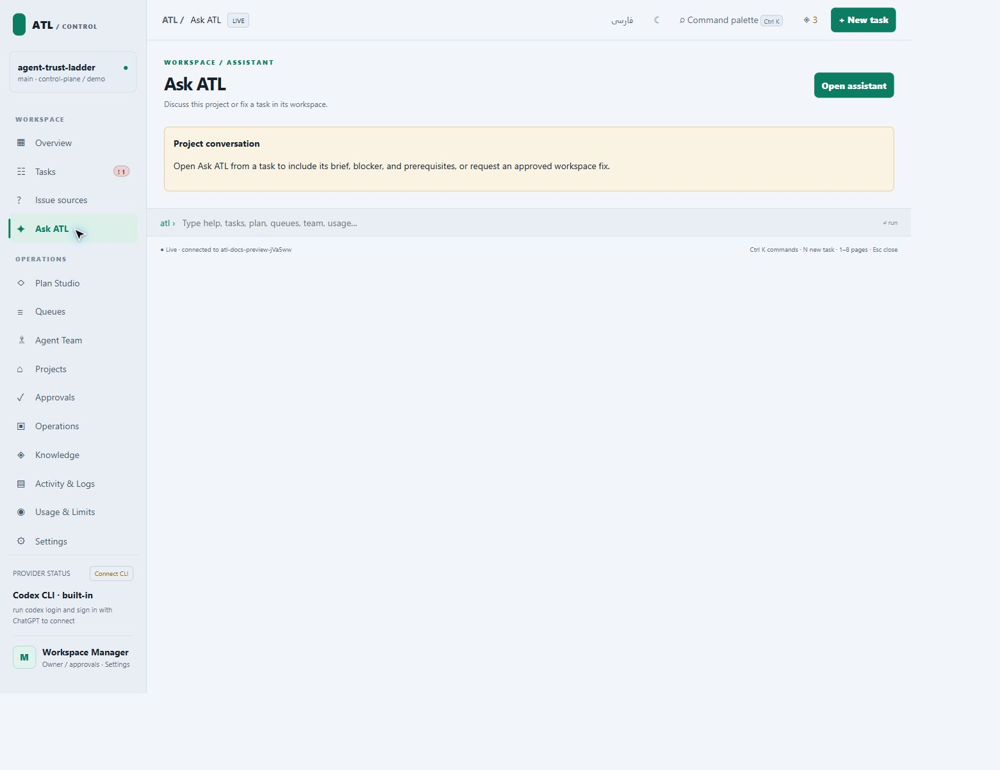

# Ask ATL conversations and workspace access

## Ask about a task

1. Open a task and choose **Ask ATL**, or open the project conversation from navigation.
2. Inspect the suggested focus and its evidence source. Use it as a starting hypothesis, not an established diagnosis.
3. Choose discussion or fix mode and inspect provider readiness and context.
4. Write the question. **Use suggested question** only fills the composer; it does not send.
5. Send deliberately. A fix needs approval of the exact request and usable workspace access.
6. Read the reply, inspect cited evidence, and retain the conversation. Completion still requires independent review and current checks.

If access fails, follow the recovery procedure below. Saving access or checking it does not automatically retry a provider request.

Ask ATL is available from a task's details or the project navigation. Each
message has a Copy button; Copy conversation includes the stored messages.
Copying preserves the original text and Markdown. Replies render paragraphs,
lists, emphasis and code without allowing message HTML to execute.

Ask ATL now opens with a suggested focus based on recorded task state. It
prioritizes unmet prerequisites, failed current-revision checks, recovery
issues, exhausted session allowances and blockers. The project conversation
points to a blocked task first. **Use suggested question** fills the composer
without sending or approving a provider run. The suggestion names its evidence
source and is a hypothesis: the provider must check it against current logs,
recovery records and workspace evidence. Older conversation turns are shortened
in the provider prompt to leave room for current evidence; the saved transcript
and Copy conversation remain complete.

The composer stays below the scrolling conversation. New output follows the
bottom until you scroll up. Jump to latest returns to new output. Provider
activity and diagnostic disclosures retain their open state during polling.
Drafts, provider choice and mode survive opening Workspace access and returning
within the same page. Ctrl/Cmd+Enter requests sending; task fixes still use the
existing exact-request approval and independent review gates.



## Recover from an access failure

1. In the conversation, choose **Fix workspace access**, or open **Workspace
   access** from the task's details.
2. Select **Read, edit and run commands in the task workspace**, then choose
   **Apply task access**. Select **Use project default** to remove an override.
3. Choose **Check workspace access**. On Windows this runs a local GapCode
   sandbox command which creates, reads and removes a unique temporary file
   in the task workspace. It uses no model session and no task-session budget.
4. Return to the conversation and choose **Prepare retry**. Inspect the message
   and use **Send message** to review the normal approval request. Saving access
   and checking access do not automatically retry the failed provider request.

For a shared default, use **Settings → Workspace access → Default workspace
access → Save access default**. This project setting applies to all models of
the built-in GapCode and Codex CLI adapters, for Ask ATL and queue workers.
Task overrides take precedence. Diagnose conversations remain read-only.
Custom CLI adapters retain their own contracts; no machine-wide GapCode/Codex
configuration is changed.

Settings are stored in `config/manager.json`:

```json
{
  "execution_access": {
    "default": "workspace-write",
    "tasks": { "T-022": "workspace-write" }
  }
}
```

Only `read-only` and `workspace-write` are accepted. An absent setting retains
the existing workspace-write default. Changes affect future runs and preserve
task budgets, evidence, repair allowances and independent review gates.
Browser mutations require the same owner session and CSRF protection as other
Control Plane operations.

## What the check proves

On Windows, GapCode now receives the named `:workspace` or `:read-only`
permission profile and the existing unelevated Windows sandbox setting.
Ask ATL previously passed only the legacy `--sandbox workspace-write` flag,
unlike queue workers. Both launch paths now share one permission adapter;
On Windows, both built-ins now receive the matching named permission profile:
the `codex` executable may itself be GapCode's standalone alias. Non-Windows
invocations keep the sandbox-mode flags. Before a real GapCode-backed fix,
ATL runs a local read/write/remove sandbox probe before charging a model
session. A failed probe returns its exact diagnostic. If a provider nevertheless
starts read-only, ATL stops it immediately and preserves that failure category.

The October 29 T-023 incident reproduced this distinction: its `codex` alias
started read-only with only `--sandbox workspace-write`, and started writable
with the matching `default_permissions=":workspace"` and Windows profile.
The local sandbox read/write/remove check passed for that selected executable.

Dependency readiness is separate. A task with dependencies needs its locked
installation and matching `.atl-dependencies.json` receipt. Set
`workspaces.provisionLocal: true` to authorize automatic offline `npm ci`
with scripts disabled. The runtime uses its project-local npm cache and never
downloads packages in that automatic route. If the cache is incomplete, it
reports the exact npm error/package. A deliberate owner-authorized dependency
installation can populate the cache; subsequent recovery verifies the receipt.
Neither readiness nor unblocking proves an acceptance check or review passed.

A successful local check proves sandbox filesystem access. It does not grant
approval to external MCP tools, override managed policy, verify a model's
commands, approve work or complete a task. If filesystem access passes but a
model's MCP tool still needs approval, inspect that tool's configuration and
approval mechanism. The interface distinguishes this tool-policy failure
from a provider account/model error. A zero exit with denied access is a
failed fix, rather than work ready for review.

## Browser tools for rendered checks

October 29, 2026 working-tree runtime: tasks whose objective, checks or skills
require rendered inspection receive the `atl_browser` MCP server in Rowan,
Sage and Beacon sessions. An integrated Beacon delivery also receives it.
Task-scoped Ask ATL **Fix** uses the same tools. Diagnose remains read-only
and does not start a browser. The built-in GapCode, Codex and Claude queue
adapters attach session-local MCP configuration. Custom provider commands
remain responsible for their own browser tooling; the runtime does not inject
an incompatible MCP configuration into them or waive their evidence gates.
No user-level provider configuration or approval policy is changed.

If the host rejects a call because its approval policy is `never`, use
**Task details → Browser access → Allow ATL test browser → Apply browser
access**. This authorizes the seven isolated preview tools for that task's
future GapCode/Codex runs. The failure panel's **Fix browser access** button
opens this control directly. Saving never starts a model run or unblocks the
task automatically; review and send the next request separately.

For a shared default, use **Settings → Browser access → Save browser
default**. Each task can **Use project default**, **Require approval**, or
**Allow ATL test browser**. A task restriction takes precedence over an
allowed project default. **Check browser runtime** starts and closes a
disposable test browser without spending a model session or task budget.
It verifies the runtime, not effective model-tool approval. Host-managed
restrictions still take precedence; the Claude adapter retains its own
permission handling.

The UI stores only this isolated-browser policy in `config/manager.json`:

```json
{
  "ui_review": {
    "browser_access": {
      "default": "approval-required",
      "tasks": { "T-022": "approved" }
    }
  }
}
```

Choosing **Use project default** removes the task override. The legacy
`ui_review.local_browser_tools_approved` flag remains a fallback when no UI
default is saved. Other MCP tools, browser profiles and live task mutations
retain their permissions. Browser changes require the existing owner
session and CSRF protection. Task budgets, recovery history and evidence are
preserved. Restart an older Control Plane server after updating its runtime.

The model starts `browser_preview`, reads `browser_snapshot`, interacts with
`browser_action`, reads computed directions and isolation with
`browser_inspect`, and calls `browser_screenshot`. The screenshot is returned
as an image to the model and saved with UTF-8 DOM/style observations, viewport,
locale, timestamps, asset hashes and a screenshot hash under the task's
`.atl-evidence/ui-review/`. `browser_viewport` supports mobile checks and
`browser_reload` refreshes repaired assets. Preview starts an isolated
Playwright browser with disposable Control Plane fixture state; it does not
use the user's Chrome profile or expose live manager mutations. Navigation
and browser requests are restricted to the fixture origin and GET/HEAD.
This initial adapter covers ATL Control Plane assets, not arbitrary websites.

Playwright must resolve from the project or task workspace. ATL prefers its
installed Chromium; `ATL_BROWSER_EXECUTABLE` can select an existing browser
binary. Missing dependencies are reported before a worker session starts;
an executable path alone does not establish a working browser connection.
`browser_preview` establishes that connection. A host denial remains an
environment blocker, not permission to relax policy or claim a PASS.

Capture receipts deliberately say **NOT OBSERVED**. The model must examine
the image, compare the requested behavior, and submit its exact check and
current source revision through the existing scoped `observe` command.
Capturing an image never completes a task or replaces independent review.
A local T-022 rendering check can precede T-024's integrated review.

Regression verification: `node verification/ui_review_mcp_test.mjs` exercises
the actual stdio handshake, provider argument injection, browser startup,
Persian fixture, image return, evidence artifacts and shutdown. It verifies
tool transport, not a model's visual judgment or T-022 completion.

An October 29 real Ask ATL smoke session without browser authorization was
denied by the host's `never` policy. A second isolated smoke project enabled
only its task's browser permission. GapCode / gpt-6-luna then called preview,
snapshot, action, inspection and screenshot tools; received and inspected
the returned image; and reported the Persian sentence as RTL with its Latin
path LTR and isolated. The transcript and screenshot are under
`.trust/browser-tool-smoke-1793253400838/`. This proves the model-to-browser
path in that environment. It does not complete T-022 or replace its review;
the live project's permissions and task state were not changed.

`verification/browser_access_test.mjs` verifies project/task inheritance,
the exact per-tool provider arguments, owner/CSRF enforcement, snapshots,
legacy compatibility and preserved budgets/state. The desktop/mobile path
through task settings, project defaults and the failure shortcut is covered
by `verification/control_plane_modal_test.mjs`. These checks are included in
the runtime CI workflow; remote CI has not been observed for this change.

## October 28, 2026 observation

T-022's saved failed fix used `gapgpt` / `gpt-6-luna`. Its diagnostic reported
command-policy denials and an MCP call requiring approval while the nested
session's approval policy was `never`. The earlier instruction to choose a
different provider conflated filesystem access with tool execution policy.

After unifying the profile arguments, a real GapCode sandbox check inside
T-022's workspace passed read/write/readback/cleanup. No additional model run
or task session was used. A model-driven repair and independent T-022 review
remain separate, unobserved gates for this change.

| Contract | Evidence | Scope / remaining uncertainty |
| --- | --- | --- |
| Project default and task overrides | `verification/execution_access_test.mjs` | Inheritance, validation, model-independent arguments, owner/CSRF rejection and budget preservation |
| Assistant/queue launch compatibility | Access, assistant and worker regression checks | Shared permission arguments; custom CLIs keep their own policy |
| Generated stylesheet | `npm run ui:css:check` | SCSS matches shipped HTML |
| Sandbox filesystem access | Local GapCode probe in T-022 | Passed; external MCP approval is separate |
| Conversation interface | Chrome desktop and narrow-screen inspection | Copy reply/error, draft return, disclosure state, composer visibility and no modal horizontal overflow observed |
| Model-driven repair and overnight completion | Not observed | No claim of completed T-022 review or successful unattended overnight run |

To roll back the settings, remove task overrides with **Use project default**
or select the prior project default. This does not restore consumed sessions
or erase failure history. Use the current project server for these endpoints;
restart an older Control Plane server after updating its runtime.
