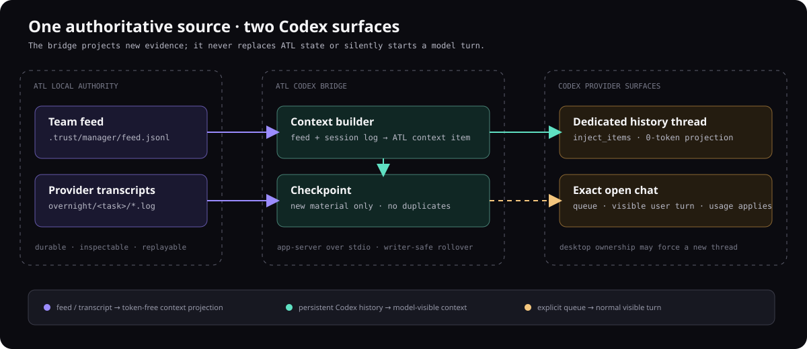

# Codex history bridge

ATL keeps the authoritative feed and provider transcripts locally, then optionally projects incremental context into a selected Codex thread. Projection and visible queue turns have different effects.

## Choose a transport

| Mode | Effect | Boundary |
|---|---|---|
| Dedicated projection | Inject context into an ATL-owned thread | Projection starts no model turn |
| New-thread fallback | Roll to a new thread when the writer is owned | History spans rollover threads |
| Explicit queue | Queue a normal message into an exact linked session | Starts a visible model turn and consumes usage |

Projection does not make later model use of that context free. Automatic fallback does not silently select queue mode.

<a id="start"></a>
## Start a dedicated history thread

From the managed application:

```sh
atl codex bridge start
atl codex bridge status
atl codex bridge sync
```

Inspect the returned thread identifier and target. ATL checkpoints imported feed/transcript cursors. Repeating sync without new material should report no new context rather than duplicate imports.

<a id="sync"></a>
## Inspect a task import

```sh
atl codex bridge sync --task T-001
atl history --source codex --n 10
```

Replace the task ID. Verify local events and transcripts before assuming projected history contains a completion result.

<a id="current-thread"></a>
## Use an exact existing conversation

Only when a visible turn is intended:

```sh
atl codex bridge link <CURRENT_THREAD_ID> --mode queue
atl codex bridge sync --task T-001
```

Confirm the target and usage boundary. A guessed thread or background queue transport can send work to the wrong conversation or spend unplanned usage.

<a id="architecture"></a>
## Locate the records

Bridge cursors and targets live under `.trust/manager/codex-bridge-state.json`. Local feed and provider transcripts remain the durable source. See [resource model](resource-model.md).



<a id="display"></a>
## Recover an import failure

For disabled transport, inspect the target. For no new context, compare checkpoints with source events. For writer conflicts, inspect rollover rather than editing provider rollout files. For missing transcripts, inspect the task session log and feed.

Source: `runtime/lib/codex-bridge.mjs` and `runtime/atl-manager.mjs`. Run `node verification/codex_bridge_test.mjs` for the contract check. Installed provider protocol compatibility needs separate live validation.
