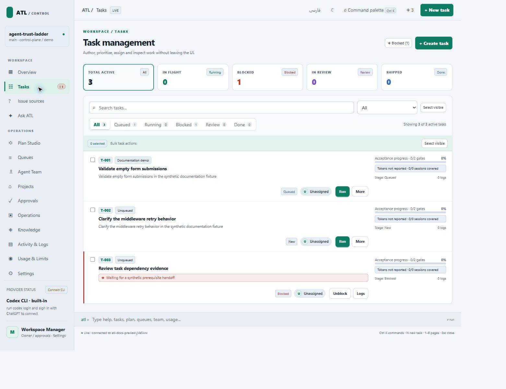
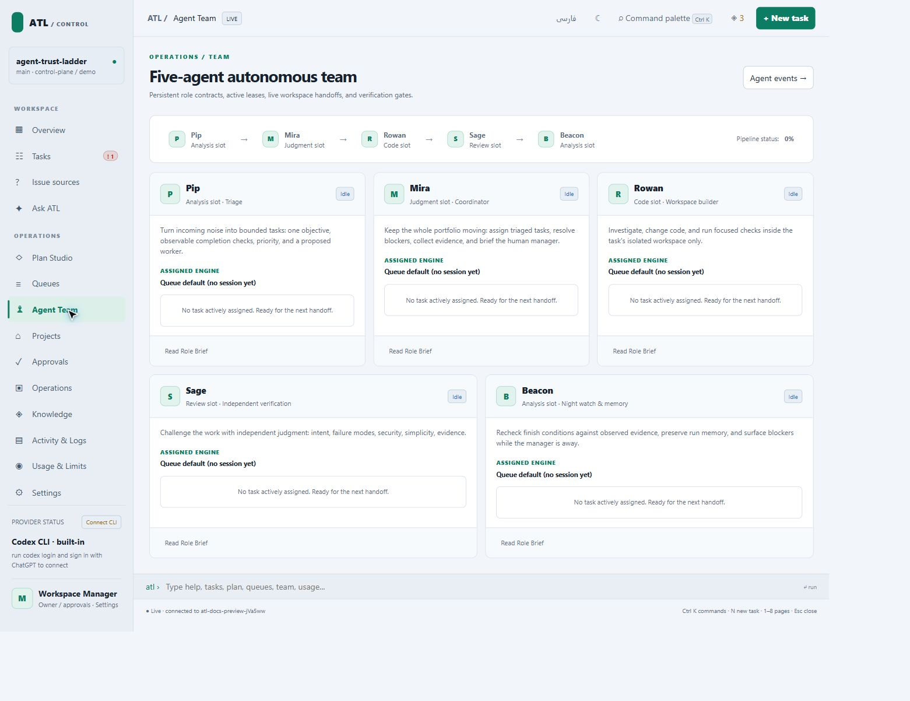

# Control Plane

The Control Plane is ATL’s local browser interface. It presents the same task, queue, provider, and evidence records used by the CLI.

## Open your project

```sh
atl ui --port 4317
```

Run from the managed application, open the printed `127.0.0.1` URL, and check the project name. See [getting started](getting-started.md) for installation and [interface reference](team-interfaces.md) for the complete menu map.

## Follow the owner workflow

1. Read **Overview** for blockers and pending decisions.
2. Use **Issue sources**, **Tasks**, or **Plan Studio** to describe work.
3. Inspect objectives, checks, prerequisites, routing, and resources.
4. Select a queue and inspect preview, budget, and blocked items.
5. Confirm execution and watch **Activity & Logs**.
6. Inspect task evidence, **Review changes**, and independent review.
7. Decide whether delivery is ready and authorize the intended action.

A preview is information. Confirmation authorizes a particular operation. Queue membership, task approval, and remote publishing have different effects.

## Recognize the screens


The overview groups portfolio state and attention items. These captures use an isolated synthetic project and contain no production issue data or provider secrets.



Task details expose the packet and evidence. Continue to [tasks and queues](tasks-and-queues.md) for execution order.



Roles express responsibilities and transition authority. Provider models are configured separately; see [agent team](team.md).

## Recover an interruption

Reopen the same project and inspect the active run, task state, blockers, and logs. Use the exposed stop or recovery operation where appropriate. Repeated launch attempts do not repair prerequisites. Follow [queue recovery](queue-recovery.md) and preserve the failed check output.

## Source and verification

Browser: `runtime/control-plane-client.js`, `runtime/control-plane.html`. Server: `runtime/lib/control-plane-server.mjs`. Projection: `runtime/lib/control-plane.mjs`. Verifiers include `verification/control_plane_server_test.mjs` and `verification/control_plane_page_reload_test.mjs`.
