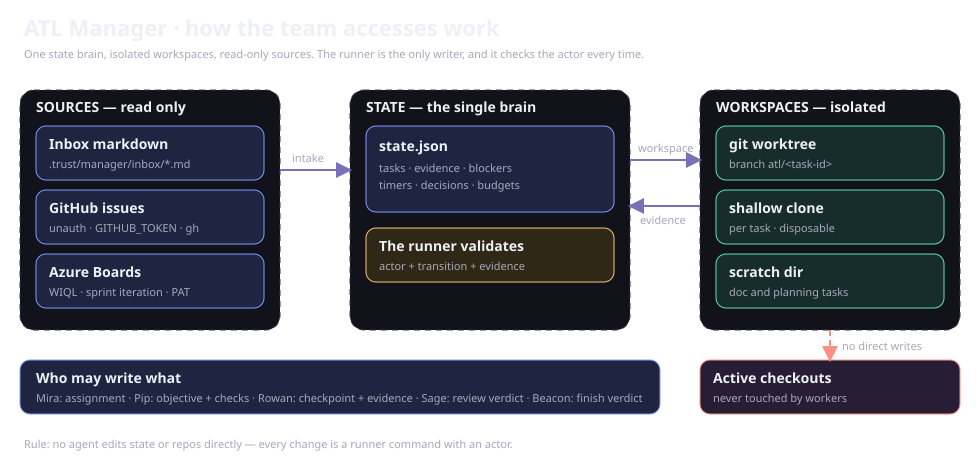

# Diagram library

Use a focused model to answer a question, then follow the implementing source for exact policy and fields. Mermaid lives in the corresponding Markdown and renders with a local bundle.

## Choose a model

| Question | Current model |
|---|---|
| How does work flow? | [Overview](overview.md#follow-the-work) |
| Which boundary owns a step? | [Architecture](architecture.md#trace-a-request) |
| Which resources reference each other? | [Resource model](resource-model.md#core-work-resources) |
| What supports trust and learning? | [Evidence relationships](resource-model.md#trust-and-learning-resources) |
| How do agents hand off? | [Team sequence](team.md#follow-the-handoff) |
| What is the conceptual lifecycle? | [Tasks and queues](tasks-and-queues.md#read-the-lifecycle) |

## Read the scope

Lifecycle models summarize workflow rather than literal status values. ER models describe JSON/file relationships, not database foreign keys. Verify identity, revision, actor permissions, and evidence in source before implementing changes.

## Existing visual sources

`docs/diagrams/` retains SVGs, Excalidraw, and earlier interface captures, preserving their URLs. Current Control Plane screenshots live under `docs/assets/screenshots/`; provenance is in the [refresh record](docs-refresh-verification.md).

## Update a model

Edit its Markdown source, trace relationships to modules, run `npm run docs:build` and `npm run docs:check`, then inspect desktop/mobile rendering. Split dense models into focused diagrams and include explanatory prose that works without an image.
