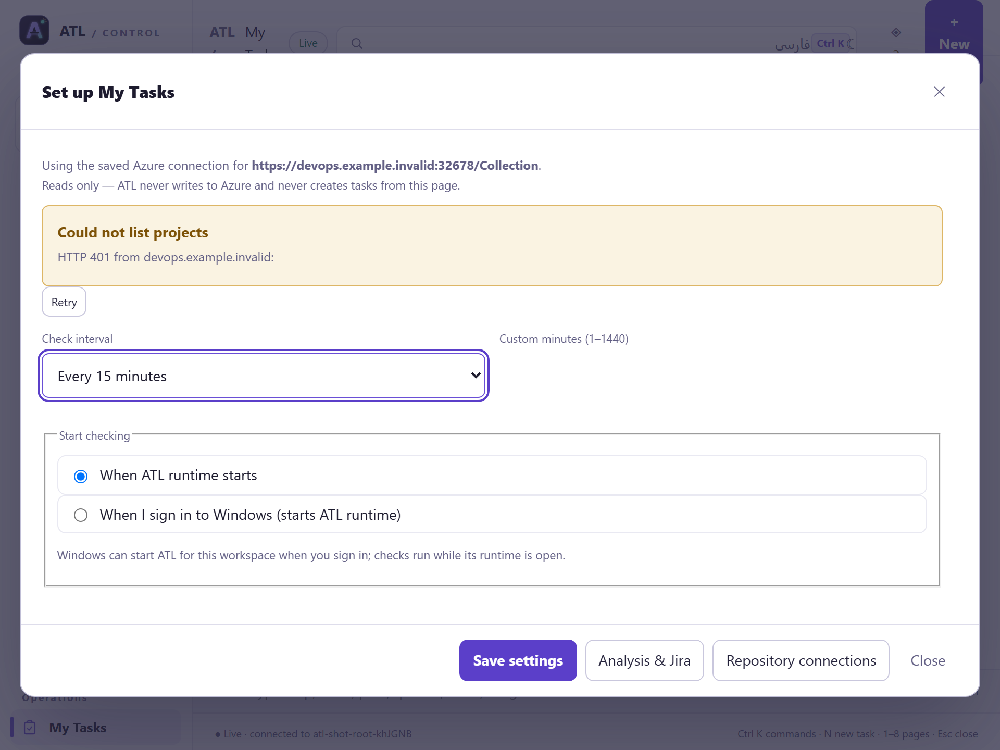
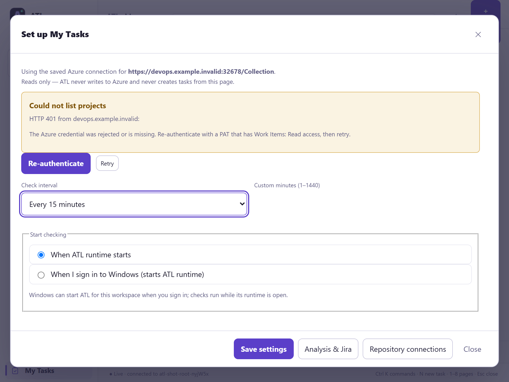
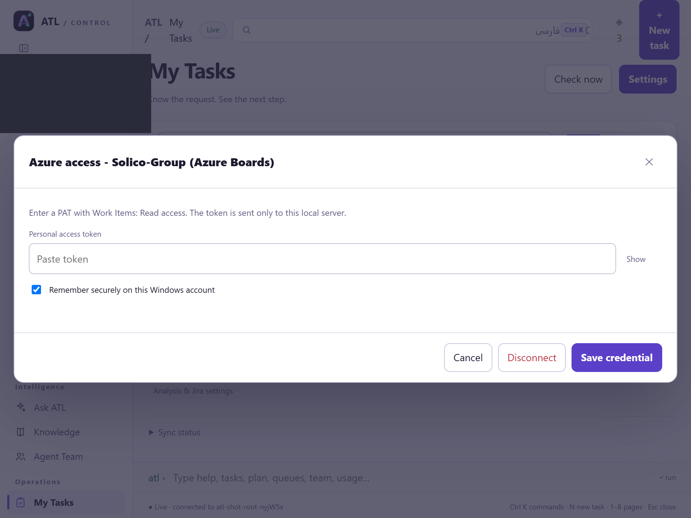

# Issue sources

Open **Inbox** to see assigned and imported requests together. Use the stage filters to find requests that need repositories, need plans, are in planning, have approved plans, or have shipped. **Assigned to me** filters to assignments from your connected account.

Open a request to read its review and link registered repositories. **Send to Plan Studio** creates or reuses a local draft for each linked repository. You can also select several imported requests and send them together. Drafts still need review and approval before they create queues.

**Repositories** shows active repositories first and keeps the idle list collapsed after the first three. Open a repository to see its requests, plans, queues and task assignment controls. To open Inbox or Repositories by keyboard, press **6** or **7** respectively.

## Add a connection

In **Inbox**, open **Sources** and choose **Add source**. Select GitHub, Jira, or Azure Boards, enter a connection name and location, then save. Each GitHub connection represents one repository. You may save several connections for the same provider. **Sources** also gives access to watch settings and the assigned-work review board.

| Provider | Location | Authentication |
|---|---|---|
| GitHub | One repository URL or `owner/repository` | Paste a session token in the source form or saved card, authenticated `gh` CLI, `GITHUB_TOKEN`, or public read access |
| Jira | HTTPS site URL and project keys | Paste a session token in the source form or saved card, or use a server environment variable (default `JIRA_TOKEN`) |
| Azure Boards | HTTPS collection URL and project; optional iteration | Paste a PAT in the source form, use **Connect PAT** on its saved card, or set a server environment variable (default `AZDO_PAT`) |

For a work item URL under `https://devops.example.invalid:32678/Collection/Project/`, enter `https://devops.example.invalid:32678/Collection` as the collection and `Project` as the project. Enter the iteration separately, for example `Project\Sprint 74`.

Saving closes the dialog and shows a notice above **Connected sources**. A failed save keeps the form and values with an inline error. Use **Check access** to verify a connection. **Pause connection** prevents previews while keeping its settings. An Azure PAT saved with **Remember securely** is protected by Windows DPAPI; session tokens for all providers expire when the server stops. Token values are never returned by the connection API.

Token and API-key inputs are masked by default; **Show** and **Hide** reveal or conceal only the value currently being entered. GitHub, Jira, and Azure accept an optional token in the source form; it is held in server memory for that session and can be replaced from the saved card. Azure also supports **Remember securely** on Windows. **Advanced authentication** holds the optional token field together with the **Token environment variable name** field — paste a token only into the token field, and enter just the variable name (`AZDO_PAT` or `JIRA_TOKEN`) into the name field, never the token itself.

Existing provider settings in `config/manager.json` appear as named connections after migration. The registry lives in `.trust/manager/issue-connections.json`; it stores locations and credential references, never tokens. Legacy CLI and My Tasks settings remain in `config/manager.json`. Removing a default connection requires pausing it or having a replacement.

My Tasks uses the Azure credential from the default enabled Issue Sources connection. If the default is paused, My Tasks uses the first enabled Azure connection. Reconnecting that source also resumes My Tasks after an authentication failure.

## Preview and import

1. Choose **Import issues** in Inbox or **Browse issues** on a source card. Select a connection to preview its issues.
2. For Azure Boards, the saved default sprint is selected when present. Choose another sprint from that connection’s list, choose **All sprints**, or enter a work item number or link and choose **Search issues**. An empty default lists work items across the project’s sprints.
3. Filter the results by title, number, state, label, or Jira project where available. Azure issue searches return up to 100 results per search. Use a sprint or a work item number to narrow the search.
4. Select the intended issues and affected repositories, then import them.
5. Return to **Inbox** to inspect the imported requests and send them to Plan Studio.

Imports keep the connection ID and name, remote issue identity, and revision. Deduplication uses the original remote issue identity, so finding the same issue through another connection does not create another request.

## Troubleshooting

Check the card's access status, enabled state, URL, project/repository, token availability, and network access. Reconnect a session token after server restart. Jira intake does not imply Jira writeback; plan publishing currently targets GitHub and Azure.

### When a credential is rejected (HTTP 401/403)

A rejected or missing credential never dead-ends in a bare retry — every auth failure offers **Re-authenticate**, which opens the saved connection's credential entry:

- **Issue sources**: a `Needs authentication` card's primary action is **Re-authenticate**; the kebab menu keeps **Replace PAT** / **Replace token**.
- **My Tasks setup**: if the project list fails with 401/403 or no credential, the dialog shows what went wrong and a **Re-authenticate** button. Saving returns you to setup with the project list reloading.
- **My Tasks board**: when checks pause with `the Azure credential was rejected`, the banner carries **Re-authenticate** and **Check now**.
- **CLI**: `atl intake status` lists every saved connection with its credential state and prints the fix line; `atl intake` pulls print `atl intake connect azure --token -` when the PAT was rejected. Saving a credential for the default Azure connection — from the UI or the CLI — also heals the legacy surface My Tasks and pulls read, so one reconnect revives every consumer.

Implementation: `runtime/lib/issue-connections.mjs`, `intake.mjs`, `composer.mjs`, and source routes in `control-plane-server.mjs`. Run `node verification/issue_connections_test.mjs`, `node verification/issue_source_ui_journey_test.mjs`, and `node verification/intake_connect_cli_test.mjs` from the clone.
