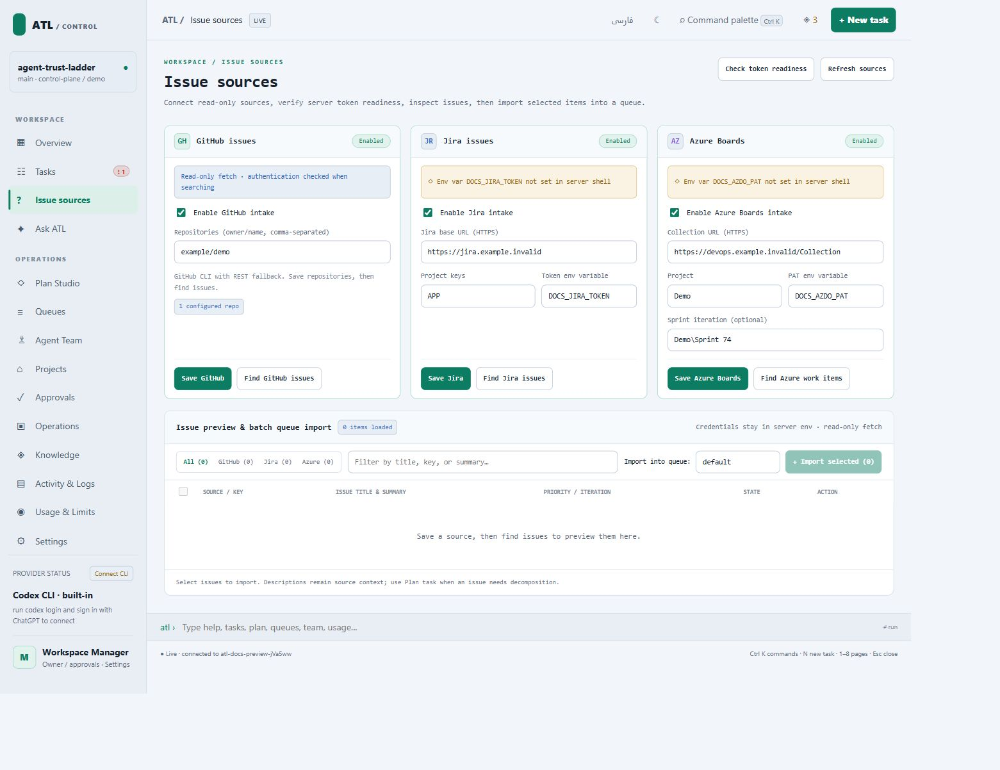

# Issue sources

Configure a connector, preview issues, then import selected candidates into a queue. Imported text needs an executable objective and completion checks before it becomes trustworthy work.

## Prerequisites

Open the managed project in the Control Plane. Have read access to the source and put credentials in the ATL server’s environment. The page stores token environment variable names, not their values. Use synthetic hosts and injected adapters for tests.

## Configure the connector

Open **Issue sources**, enter its fields, and save.

| Source | Enter | Authentication |
|---|---|---|
| GitHub | Repository names such as `example/demo` | Authenticated `gh` CLI or `GITHUB_TOKEN`; public repositories may allow anonymous reads |
| Jira | Base URL such as `https://jira.example.invalid`, project keys `APP, OPS` | Token variable, default `JIRA_TOKEN` |
| Azure Boards | Organization/collection URL, project, optional iteration | PAT variable, default `AZDO_PAT` |

For `https://devops.example.invalid:32678/Collection/Project/_workitems/recentlyupdated/`, enter `https://devops.example.invalid:32678/Collection` as the organization URL and `Project` as the project. A sprint taskboard URL is a browser view, not the connector base. Enter the iteration separately, for example `Project\Sprint 74`.

Expected result: a settings-saved message. Saving does not import issues.

## Preview and import

1. Choose **Preview** for a configured source.
2. Search or filter candidates.
3. Select the intended issues and import them.
4. Inspect the reported queue, then open **Tasks** and **Queues**.
5. Check the imported source identity, revision, objective, and checks.

Preview creates no tasks. Import creates local candidates with source identity and revision metadata. Deduplication is source-aware; avoid editing identities by hand.

## Plan description-only work

Open the imported request in **Plan Studio**. Record constraints and questions, generate a repository-grounded plan, inspect proposals, and request separate review. Resolve findings before approving a new queue. A local template is a preview, not a provider-reviewed plan.

A changed source revision invalidates approval evidence. Refresh and review against the current issue. See [Plan Studio](plan-studio.md) and its [contract](plan-studio-contract.md).

## Recover connector errors

Check enablement, URL shape, selected repositories/projects, token availability in the server environment, and network access. Preserve the adapter error. Do not substitute a production issue for an offline fixture. Jira intake does not imply Jira writeback; plan publishing currently targets GitHub/Azure.

## Source and checks

Implementation: `runtime/lib/intake.mjs`, `composer.mjs`, and source routes in `control-plane-server.mjs`. Run `node verification/jira_adapter_contract_test.mjs`, `node verification/github_adapter_contract_test.mjs`, `node verification/azure_issue_journey_test.mjs`, or `node verification/issue_source_ui_journey_test.mjs` from the clone.

The [recorded mock E2E run](mock-system-e2e-2026-10-29.md) demonstrates orchestration with fixture workers. It does not establish that real issues were fixed or remote PRs published.
