# Agent Trust Ladder

ATL coordinates engineering work through explicit requirements, bounded execution, independent review, and recorded evidence. Use its agent skills to guide an engineering session, or its local Control Plane to manage tasks, plans, queues, providers, and execution history.

## Start with your goal

| You want to… | Read |
|---|---|
| Install ATL and open a project | [Getting started](getting-started.md) |
| Connect Jira, GitHub, or Azure Boards | [Issue sources](issue-sources.md) |
| Turn a description into executable work | [Plan Studio](plan-studio.md) |
| Run approved work within a budget | [Tasks and queues](tasks-and-queues.md), [overnight runs](overnight-runs.md) |
| Understand the implementation | [Architecture](architecture.md), [resource model](resource-model.md), [file catalog](repository-map.md) |
| Contribute code or documentation | [Development](development.md), [documentation workflow](documentation.md) |

## Follow the work

```mermaid
flowchart LR
  accTitle: From issue to delivery decision
  accDescr: Clarify an issue, review tasks, queue bounded execution, and collect independent review and verification before delivery.
  A[Issue or request] --> B[Clarify and plan]
  B --> C[Reviewed tasks]
  C --> D[Execution queue]
  D --> E[Bounded worker sessions]
  E --> F[Independent review]
  F --> G[Verification evidence]
  G --> H[Owner delivery decision]
```

A queue coordinates work; it does not turn an unclear request into a verified fix by itself. A finished provider session is evidence of execution, not proof of correctness. Review, verification, and delivery permissions remain separate decisions.

## What is available

The browser includes project overview, issue sources, task management, Plan Studio, named queues, agent roles, activity, usage, providers, approvals, operations, knowledge, and settings. Task details include Ask ATL, relationships, evidence, and captured change review. The runtime adds CLI automation, isolated workspaces, recovery, history transport, research records, source navigation, backups, and a multi-project supervisor.

Use the [feature map](guides.md) to find each procedure, implementing module, and verifier. Search indexes every public guide. Diagrams render locally without a CDN and remain readable as Mermaid source in Markdown.

This documentation describes the October 29, 2026 source snapshot and package version 0.1.3. Screenshots use synthetic local data. See the [verification record](docs-refresh-verification.md) for checks and limits.
