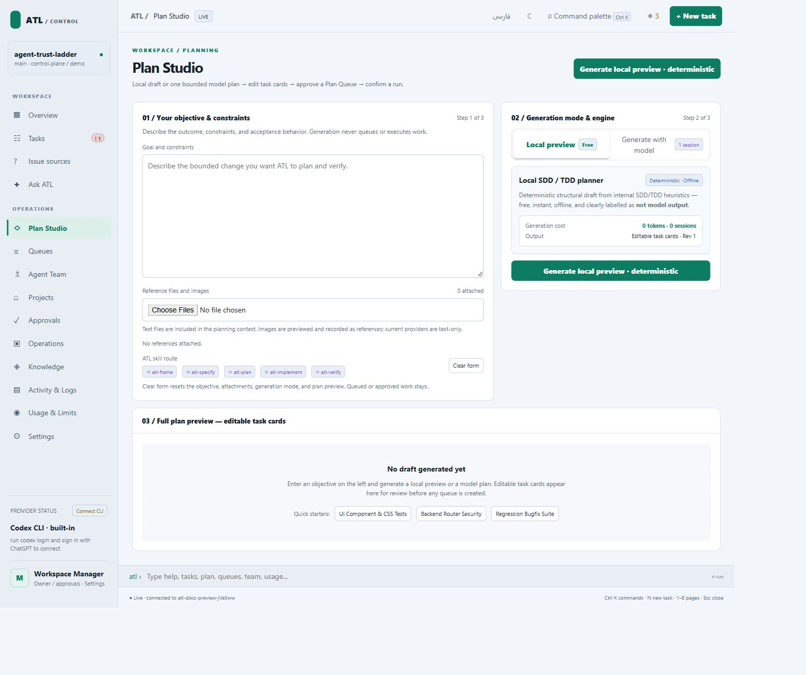

# Plan Studio

Use Plan Studio when a request describes an outcome but lacks independently executable tasks. Planning proposes work; review and owner approval decide whether it can enter an execution queue.

## Prepare the request

Open **Plan Studio** with a request or imported issue. State the outcome, constraints, project, and acceptance examples. Distinguish observed evidence from assumptions. Start with [issue sources](issue-sources.md) for external work.

## Generate and review

1. Inspect planning provider readiness and resource allowance.
2. Generate a plan and inspect requirements, evidence, assumptions, questions, risks, and task proposals.
3. Answer questions and correct objectives, deliverables, prerequisites, files, checks, and skill reasons.
4. Request separate provider review of the current artifact.
5. Resolve blocking findings and verify the source revision.
6. Approve the reviewed artifact to create an execution queue.

Expected result: an approved plan creates bounded task packets in a queue. Editing after review invalidates its binding. A stale source revision blocks approval. A description or local preview is insufficient evidence.

## Publish deliberately

Inspect **Publish destination**, preview its GitHub or Azure destination, then confirm the exact publication. Local queue creation and remote issue creation are separate operations. Inspect existing publication mapping before retrying to avoid duplicates.

## Resolve an approval block

Read validation findings. Missing answers, insufficient checks, stale sources, legacy artifacts, and unresolved review findings need an updated artifact and review. See the [plan contract](plan-studio-contract.md) for fields and bindings.

Source: `runtime/lib/plan-studio.mjs`, `plan-model.mjs`, `plan-publish.mjs`. Checks: `verification/plan_contract_test.mjs`, `plan_studio_journey_test.mjs`, and `plan_publish_test.mjs`.
