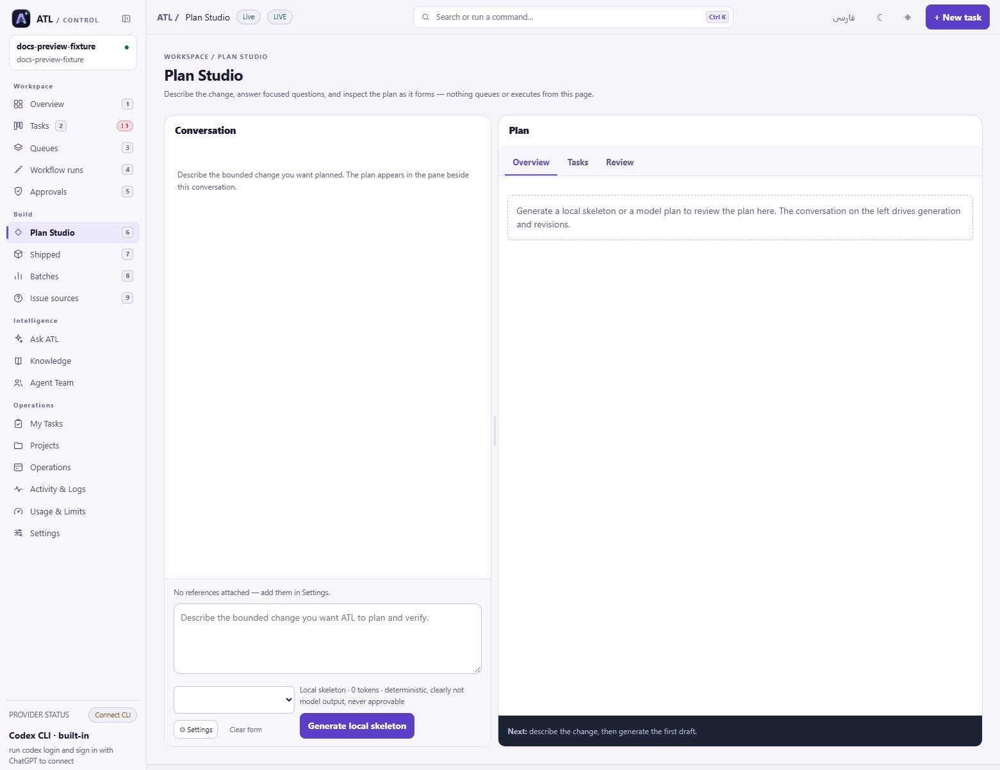

# Plan Studio

Use Plan Studio when a request describes an outcome but lacks independently executable tasks. Planning proposes work; review and owner approval decide whether it can enter an execution queue.

The Studio is a conversational workspace: the **conversation** on the left drives generation and revisions, the **plan** on the right (Overview / Tasks / Review tabs) always shows the saved artifact. Nothing queues or executes from this page.

## Prepare the request

Open **Plan Studio** with a request or imported issue. State the outcome, constraints, project, and acceptance examples in the composer — Enter adds a line, Ctrl/Cmd+Enter sends. Distinguish observed evidence from assumptions. Attach reference files from **⚙ Settings**, and start with [issue sources](issue-sources.md) for external work.

## Generate and review

1. Inspect planning provider readiness (compact provider selector beside the composer; model, thinking effort, attachments, and skeleton mode live in **⚙ Settings**).
2. **Generate plan** sends one bounded provider call (or a free deterministic local skeleton) and the plan appears beside the conversation.
3. Consequential questions render as inline cards in the conversation with suggested answers and a custom answer field. Unresolved questions block readiness — the header and next-step bar say so explicitly.
4. Refine conversationally: with a draft open, the composer submits **Update plan** — one bounded refinement call that proposes a full candidate plan. The proposal lands in the Tasks tab as **Proposed changes · based on rev N** with added, changed, and removed task cards. **Apply changes** writes it against its originating revision (a manual edit in between makes it stale and refused with a reload-and-retry message; applying clears review readiness). **Discard** drops it. Manual edits and failed calls never touch the saved plan.
5. Edit task cards directly (instructions, deliverables, dependencies, files, checks, skill reasons, worker) or ask about a single task from its card.
6. Request separate provider review of the current artifact (accuracy or deep review).
7. Resolve blocking findings and verify the source revision.
8. Approve the reviewed artifact to create an execution queue.

The persistent next-step control (header and plan-pane bar) names the one useful action — answer questions, review proposed changes, request review, resolve findings, or approve to queue — and explains any disabled state beside itself. Reopening a saved draft restores its conversation; drafts from before this workspace open with an empty conversation.

Expected result: an approved plan creates bounded task packets in a queue. Editing after review invalidates its binding. A stale source revision blocks approval. A description or local preview is insufficient evidence. Below 960 px the workspace switches to Conversation/Plan tabs; the split is drag-resizable on desktop.

## Publish deliberately

Inspect **Publish destination**, preview its GitHub or Azure destination, then confirm the exact publication. Local queue creation and remote issue creation are separate operations. Inspect existing publication mapping before retrying to avoid duplicates.

## Choose the review depth

Plan Studio offers two review depths before approval. **ATL accuracy review** is one schema-gated model call. **EGM deep review** runs the Elephant–Goldfish–Model review protocol: five independent stage reviewers plus a synthesizer, each a fresh single-shot call with no shared conversation.

The backend is selected in `config/manager.json` under `egmReview`:

- `"backend": "glm-goldfish"` — the protocol natively through ATL's planning seam with any configured provider (for example GLM). Needs only `enabled`, `backend`, and the pinned `versionSha`.
- `"backend": "codex"` (default) — the real EGM plugin through a dedicated CODEX_HOME: `codexHome`, `model`, pinned `versionSha`, the plugin installed, and `codex login` completed for that home.

A missing or unusable configuration is refused explicitly before any spend. Every finding is bound to the reviewed artifact and evidence snapshot: a plan or evidence change invalidates the review, and a blocked or stale deep review keeps the approval gate shut — the same contract as the accuracy review. Failed, timed out, or incomplete deep reviews are recorded as failures with their raw run preserved beside the draft, never as a clean pass.

## Resolve an approval block

Read validation findings. Missing answers, insufficient checks, stale sources, legacy artifacts, and unresolved review findings need an updated artifact and review. See the [plan contract](plan-studio-contract.md) for fields and bindings.

Source: `runtime/lib/plan-studio.mjs`, `plan-model.mjs`, `plan-publish.mjs`. Checks: `verification/plan_contract_test.mjs`, `plan_studio_refine_test.mjs`, `plan_studio_refine_api_test.mjs`, `plan_studio_journey_test.mjs`, and `plan_publish_test.mjs`.
