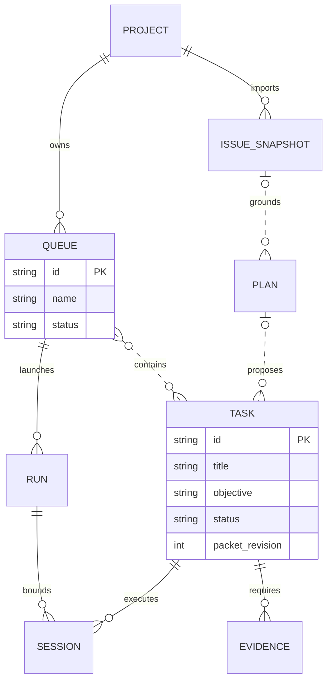
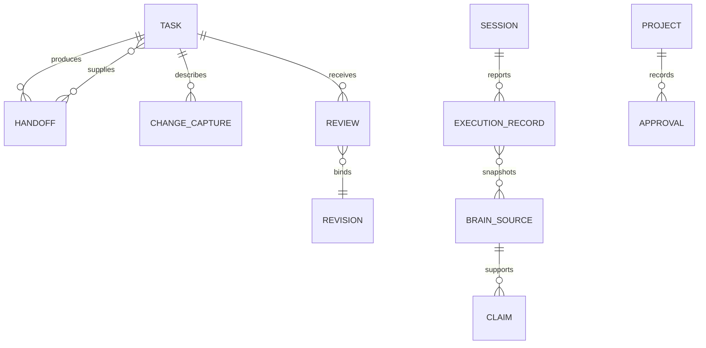

# Resource and file model

Use this model to locate a resource and trace the evidence behind a task. Relationships describe local JSON, JSONL, files, and Git workspaces; ATL does not require a relational database.

## Core work resources

A queue references task IDs rather than copying tasks. Tasks can appear in several queues; overlapping queue reports must not be summed as a project total. Plans carry review and source-revision bindings before proposals become executable work.

Issue and plan links are optional: a plan can start from a manual request, and a task can be created without a plan. `SESSION` here means a task execution session. Planning calls are recorded separately and can be shared at draft/queue level.

## Trust and learning resources

Handoffs supply prerequisite artifacts. Change captures support inspection, not acceptance. Reviews must match the implementation revision. Brain claims remain source-backed and advisory; current checks still govern completion.

## Persistent file map

Paths are relative to the managed project unless stated otherwise. Owner modules are under `runtime/lib/`.

| Resource | File or directory | Purpose and references | Owner |
|---|---|---|---|
| Project policy | `config/manager.json` | Intake, provider defaults, budgets, routines, resource policy | `launch.mjs`, `intake.mjs` |
| Lifecycle contract | Runtime `config/manager-state-contract.json` | Statuses, actors, and allowed transitions | `state.mjs` |
| Routing | `config/model-routing.json`, `config/skill-routing.json` | Task classes, role models, skill policy | `skill-router.mjs`, `jev.mjs` |
| Tasks | `.trust/manager/state.json` | IDs, objectives, checks, source, prerequisites, evidence, revision | `state.mjs` |
| Queues | `.trust/manager/queue.json` | Named work sets, active selection, policy, task references | `queue.mjs` |
| Plans | `.trust/manager/plan-studio/` | Input, artifact, review bindings, source snapshots, publication mapping | `plan-studio.mjs`, `plan-publish.mjs` |
| Approvals | `.trust/manager/approvals.json` | Proposals, decisions, grants, action outcomes | `approvals.mjs` |
| Workspaces | `.trust/manager/workspaces/`, workspace archive | Isolated implementation files and repository context | `workspace.mjs` |
| Handoffs | `.trust/manager/handoffs/`, `blobs/` | Prerequisite manifests and content-addressed immutable artifacts | `handoffs.mjs` |
| Change captures | `.trust/manager/change-reviews/` | Source/output metadata and file review material | `change-review-store.mjs` |
| Execution ledger | `.trust/manager/execution-ledger.jsonl` | Session IDs, configured provider/model, observed usage | `execution-report.mjs` |
| Run records | `.trust/manager/overnight/` | Bounded run state and recovery context | `launch.mjs` |
| Ask ATL | `.trust/manager/assistant/` | Task/global conversations and request context | `control-assistant.mjs` |
| Brain | `.trust/manager/brain/` | Sources, immutable raw snapshots, claims, context packs, events | `brain.mjs` |
| Resource calibration | `.trust/manager/resource-learning.json` | Qualifying verified history for bounded calibration | `resource-policy.mjs` |
| Activity | `.trust/manager/feed.jsonl`, `notifications.jsonl` | Narration and attention items, separate from evidence | Feed/notification modules |
| Research | `research/index.json`, `research/records/` | Reviewed candidates, sources, transcripts, retrospectives | `research.mjs` |
| Verification artifacts | `.atl-evidence/` | Commands, reports, screenshots, failure evidence | Verification harnesses |
| Documentation source | `docs/*.md`, `docs/site.json` | Editable guides and public navigation | `scripts/build-docs.mjs` |
| Website output | `docs/*.html`, `search-index.json`, `vendor/` | Generated pages, search, pinned Mermaid bundle | `scripts/build-docs.mjs` |

Features create records when used; an empty project will not contain every resource. User-scoped credentials are not portable project data and must not enter examples or screenshots.

## How to trace a task

1. Find its ID in Tasks or `atl show T-001`.
2. Inspect its source revision and originating plan.
3. Follow queue membership and bounded run records.
4. Check sessions, prerequisite handoffs, current review, and completion checks.
5. Inspect delivery records for the actual output boundary.
6. Follow linked Brain/calibration sources to see what was learned.

For literal fields and statuses, read `config/manager-state-contract.json` and implementing modules through the [file catalog](repository-map.md). Update these models whenever identity, persistence, or lifecycle ownership changes.
