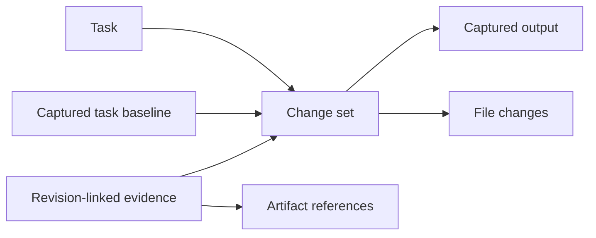

# Reviewing task changes

Open a task in the live Control Plane with **Activity**, **Changes** and **Process** tabs. Activity keeps the task list beside the workspace. Changes and Process use the full workspace width; the back control returns to the list. The same workspace runs in browser and bundled harness panels. Changes opens the searchable file tree and captured diff, with Overview, Evidence and Relationships available as secondary review sections. File and hunk links open their associated capture. Inspection does not start workers, change task status, or grant delivery approval.

## Operator workflow

1. Read the status and attention items on Overview. Blocked tasks remain blocked even when checks passed. Title, objective, and latest summary come from task records.
2. Check the baseline/output content identifiers and capture time. These are SHA-256 source revisions, not Git commits. The revision selector opens earlier captures. **Refresh evidence** keeps the selected source pinned.
3. Open Changes to land directly in the searchable file tree and diff. Search covers every path in the captured change set, including paths beyond the initial metadata page. Expand directories or filter by change type. Use **Previous/Next file** and **Previous/Next hunk**, or `J`/`K` and `N`/`P` outside editable controls; `C` opens a file comment. Unified and split views use the same parsed captured patch. Use **Load more files** for later metadata pages. Patches load individually. Narrow panels show either the list or diff, with **Back to files** navigation.
4. Add file or old/new line comments, reply in a thread, resolve or reopen it, and mark a file reviewed. Notes are local to ATL and keyed to the pinned capture. Notes on other captures remain visibly historical. A stale save returns a conflict; **Refresh evidence** reloads the review revision while retaining the draft. Revision, selected file, per-file drafts and scroll positions, split view and list width survive refreshes. Switching files never retargets an unfinished comment.
5. Open Evidence. `current` means both packet and code revision match; result and coverage remain separate. Revisionless evidence is `unknown`; old and invalidated evidence stay visibly labeled. Task-level evidence is not automatically proof for one file.
6. Open Relationships to inspect actual task, change-set, snapshot, file, evidence and artifact-reference data. File records open diffs; evidence records open observations. Artifact hashes are references only, without a content-availability claim. Run links and structured decisions are explicitly unavailable when not established by source records.

Completed handoffs can be inspected after their workspace is archived. Active or blocked work needs **Capture current changes**. Capture stores immutable inspection data and compares two successive snapshots; a mismatch prevents publication. It never invents a missing baseline from Git HEAD. Pause a busy worker before capturing if consistency errors persist.

## Model and trust boundary



| Record | Contract |
|---|---|
| Change set | Version 1, deterministic ID from task + packet + baseline + output, task ID, packet revision, capture time, source kind, nullable run ID and imported input revisions. |
| Snapshot | Existing `{revision, files, modes}` identity; retain source bytes/hashes. |
| File change | Path-derived ID, relative path, kind, before/after hashes and modes. Add/modify/delete/mode-only changes are supported; rename inference is deferred. |
| Evidence | Existing observation plus stable inspection reference and freshness. Matching requires explicit packet/code revisions. |
| Artifact | Observation hash and evidence/revision pointers; `reference_only` does not prove the artifact is available. |
| Directory | Derived grouping of loaded paths, not a separate ownership record. |
| Attention | Deterministic blocker, missing verification/review, stale evidence or failed/incomplete observation flags. No generated assurance score. |

`state.json` owns lifecycle/evidence; `handoffs.mjs` owns verified handoffs. Inspection artifacts cannot satisfy completion checks or approvals. Context knowledge stays advisory. Comparing captured baseline to output excludes pre-existing dirty files unchanged by the worker. Imported predecessor revisions remain visible; a composed diff is not an authorship claim.

## Storage and API

Captures publish `.trust/manager/change-reviews/<task-id>/<change-set-id>.json` and reuse `.trust/manager/handoffs/blobs/<sha256>`. Blobs precede manifest publication. A same-volume hard link publishes manifests without replacing a concurrent capture with the same ID; partial temporary files are ignored. Completed handoffs use the existing validator. A bounded cache reuses validated handoffs while identity/file metadata stay unchanged; requested blob previews always verify hashes again.

| Endpoint | Purpose |
|---|---|
| `GET /api/task-changes?taskId=...&changeSetId=...&cursor=...&limit=...&q=...&kind=...` | Pinned/latest metadata, history, evidence and attention. Path search and change-type filtering precede pagination; does not create captures. |
| `GET /api/task-change-diff?taskId=...&changeSetId=...&fileId=...` | Bounded preview for a file belonging to that task/change set. |
| `POST /api/task-changes/capture` | Explicit capture; JSON `{ "task_id": "T-001" }`. |
| `GET /api/task-execution?taskId=...` | Read-only execution projection for the workspace Activity/Process views (stages, attempts, captures, checks). |
| `GET /api/task-impact-children?taskId=...&changeSetId=...&fileId=...&cursor=...` | Pinned graph expansion. Omit `fileId` to page through captured files; supply it to page through that file's captured patch hunks. Returns at most 100 child nodes, provenance edges, availability and next cursor. |
| `GET /api/task-review-state?taskId=...` | Read local comments, resolutions and reviewed files. |
| `PUT /api/task-review-state` | Optimistic revision update. Requires `expected_revision`, task, pinned change-set id, file id, and an action (`comment`, `reply`, `resolve`, `reopen`, `reviewed`). Replies name `comment_id`; line anchors must exist in the pinned complete patch. |

All of these require the owner cookie and `x-atl-csrf` header, including source-reading GET requests. Capture also uses the existing origin checks. The browser never supplies arbitrary filesystem paths. Periodic snapshots/SSE contain no patches or new capture work. Paths reject traversal, symlinks and Windows junctions. Record associations, manifest hashes and requested blob hashes are checked.

## Execution projection

The workspace Activity and Process views read `GET /api/task-execution`, a pure join over existing state events, execution sessions, captures and task evidence. Stages appear when recorded events, session roles or evidence kinds map to them. Attempts keep actors, provider/model, windows, exit outcomes, commands, evidence and checkpoints. Session-linked evidence is recorded; association by a shared packet revision is inferred. All retained checks remain chronological, including a failure followed by a passing retry.

The additive graph connects objectives, attempts, captures, files, patch hunks, checks and recorded outcomes. Edges say `recorded`, `inferred` or `unknown`; a task-level check never proves file coverage. Large graphs collapse by stage and directory, with further hunk groups by file. The accessible list exposes **Load more captured files** and **Expand captured hunks** for every deferred page. Limits on the initial projection never permanently hide valid captured files or hunks. Binary, redacted or bounded-out patches retain their actual availability.

Both Execution and Code impact support zoom, pan, fit, SVG export, Mermaid source copy and an accessible list. Mermaid is generated from the structured graph and rendered with strict security and SVG text labels. Clipboard denial opens selectable source. Hunk navigation uses the exact capture and patch index. No provider call occurs when a task or diagram opens.

Review state is stored at `.trust/manager/change-reviews/<task-id>/review-state.json` (version 1, maximum 16 MiB). Updates use the shared local transaction lock, expected revision, a temporary file and atomic rename. Dead lock owners can be recovered; concurrent or stale writes return a conflict. Comments do not alter task lifecycle, captures or GitHub.

Terminal users can inspect the same report without the dashboard:

```text
atl review T-001
atl review T-001 --json
atl review T-001 --mermaid
atl review T-001 --capture <capture-id> --expand --cursor 200 --json
atl review T-001 --capture <capture-id> --expand --file <file-id> --cursor 100 --mermaid
```

Harness integrations expose the read-only `atl_review` tool with `project`, `taskId`, optional `format` (`text`, `json`, `mermaid`), `captureId`, `expand`, `fileId` and `cursor`. It reads the selected project directly without starting a daemon, worker or provider.

## Bounds and missing data

- Metadata returns at most 100 file rows/page. Line totals describe computed rows in that page and are labelled partial when incomplete; binary and redacted rows retain unknown totals. No verification badge is inferred from local reviewed-file tracking.
- Text allows 1 MiB/side, 20,000 lines/side and 256 KiB patch output. Line comparison caps its LCS matrix at 2,000,000 cells with a five-second computation budget. Limits/timeouts are explicit states; binary/non-UTF-8 content is labeled binary.
- Capture preflight caps source at 10,000 files, 32 MiB/file and 128 MiB total. Git enumeration has a five-second limit. A capture taking over ten seconds does not publish an inspection manifest. These are synchronous local captures; large workspaces can briefly occupy the server. No automatic captures are enabled.
- `.env*`, credential/secret files, private-key containers and common token assignments suppress the whole preview as `redacted`. This conservative filter is not a guarantee that every secret is detected. Source blobs retain original bytes; keep sensitive content out of task workspaces under existing workspace policy.
- Missing baseline returns `baseline_missing`, uncaptured work `capture_required`. Missing workspaces/blobs and corruption stay explicit. A corrupt newest record is not silently displayed as empty changes. Earlier explicit captures remain independent of task packet changes.
- Two filesystem observations cannot prove transactional consistency or detect a change-and-revert between them. Capture checks the task's packet/baseline/workspace/input contract again before publication. It does not lock an active worker.
- Existing global shortcuts are suspended inside the dialog. Tabs, directory controls and focus cycling use native controls; code/paths remain isolated LTR in Persian layouts.
- No scheduled digest, automatic retention cleanup or shared-blob deletion is introduced. Structured decision capture and semantic dependency analysis remain follow-up work.

## Verification and rollback

```text
node verification/task_changes_test.mjs
node verification/change_review_store_test.mjs
node verification/task_changes_api_test.mjs
node verification/task_changes_ui_test.mjs
node verification/execution_projection_test.mjs
node verification/task_ui_workspace_test.mjs
node verification/task_review_acceptance_test.mjs
node verification/control_plane_plugin_ui_test.mjs
node verification/control_plane_modal_test.mjs
npm run ui:css:check
```

The controller suite uses a DOM double for asynchronous state and escaping. The workspace and acceptance suites launch Chromium against the real server. The acceptance fixture contains 236 changed files, a 150-hunk patch, failed and passing attempts, and binary/redacted files. It checks paged expansion, exact source parity, keyboard navigation, annotation history, reload retention, accessible labels, browser/harness presentation, themes and RTL. Captures and browser accessibility snapshots are written under `.atl-evidence/task-review-workspace/`. These checks observe Chromium's accessibility tree and keyboard behavior; they do not certify an external screen reader.

The live server loads the additive `ATL_CHANGE_REVIEW` UI capability. Rollback removes its script injection/action and three routes, retaining inspection artifacts. Execution and delivery gates do not depend on this new store. The optional morning digest is deferred.
