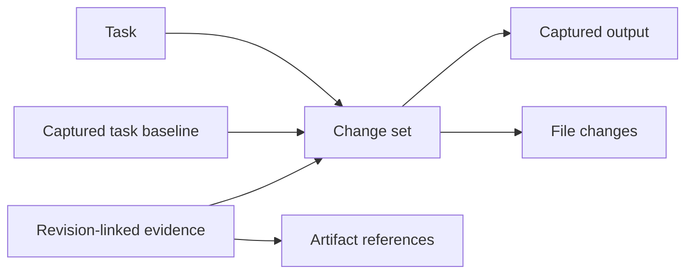

# Reviewing task changes

Open a task in the live browser Control Plane and select **Review changes**. **Diagram** opens the Relationships tab. Inspection does not start workers, change task status, or grant delivery approval.

## Operator workflow

1. Read the status and attention items on Overview. Blocked tasks remain blocked even when checks passed. Title, objective, and latest summary come from task records.
2. Check the baseline/output content identifiers and capture time. These are SHA-256 source revisions, not Git commits. The revision selector opens earlier captures. **Refresh evidence** keeps the selected source pinned.
3. Open Files. Expand directories, search loaded paths, or filter by change type. Select a file to load its diff. Use **Load more files** to include later pages in search/filtering. Patches load individually.
4. Open Evidence. `current` means both packet and code revision match; result and coverage remain separate. Revisionless evidence is `unknown`; old and invalidated evidence stay visibly labeled. Task-level evidence is not automatically proof for one file.
5. Open Relationships to inspect actual task, change-set, snapshot, file, evidence and artifact-reference data. File records open diffs; evidence records open observations. Artifact hashes are references only, without a content-availability claim. Run links and structured decisions are explicitly unavailable when not established by source records.

Completed handoffs can be inspected after their workspace is archived. Active or blocked work needs **Capture current changes**. Capture stores immutable inspection data and compares two successive snapshots; a mismatch prevents publication. It never invents a missing baseline from Git HEAD. Pause a busy worker before capturing if consistency errors persist.

## Model and trust boundary



| Record | Contract |
|---|---|
| Change set | Version 1, deterministic ID from task + packet + baseline + output, task ID, packet revision, capture time, source kind, nullable run ID and imported input revisions. |
| Snapshot | Existing `{revision, files, modes}` identity; retain source bytes/hashes. |
| File change | Path-derived ID, relative path, kind, before/after hashes and modes. Add/modify/delete/mode-only changes are supported; rename inference is deferred. |
| Evidence | Existing observation plus stable inspection reference and freshness. Matching requires explicit packet/code revisions. |
| Artifact | Observation hash and evidence/revision pointers; `reference_only` does not prove the artifact is available. |
| Directory | Derived grouping of loaded paths, not a separate ownership record. |
| Attention | Deterministic blocker, missing verification/review, stale evidence or failed/incomplete observation flags. No generated assurance score. |

`state.json` owns lifecycle/evidence; `handoffs.mjs` owns verified handoffs. Inspection artifacts cannot satisfy completion checks or approvals. Context knowledge stays advisory. Comparing captured baseline to output excludes pre-existing dirty files unchanged by the worker. Imported predecessor revisions remain visible; a composed diff is not an authorship claim.

## Storage and API

Captures publish `.trust/manager/change-reviews/<task-id>/<change-set-id>.json` and reuse `.trust/manager/handoffs/blobs/<sha256>`. Blobs precede manifest publication. A same-volume hard link publishes manifests without replacing a concurrent capture with the same ID; partial temporary files are ignored. Completed handoffs use the existing validator. A bounded cache reuses validated handoffs while identity/file metadata stay unchanged; requested blob previews always verify hashes again.

| Endpoint | Purpose |
|---|---|
| `GET /api/task-changes?taskId=...&changeSetId=...&cursor=...&limit=...` | Pinned/latest metadata, history, evidence and attention; does not create captures. |
| `GET /api/task-change-diff?taskId=...&changeSetId=...&fileId=...` | Bounded preview for a file belonging to that task/change set. |
| `POST /api/task-changes/capture` | Explicit capture; JSON `{ "task_id": "T-001" }`. |

All three require the owner cookie and `x-atl-csrf` header, including source-reading GET requests. Capture also uses the existing origin checks. The browser never supplies arbitrary filesystem paths. Periodic snapshots/SSE contain no patches or new capture work. Paths reject traversal, symlinks and Windows junctions. Record associations, manifest hashes and requested blob hashes are checked.

## Bounds and missing data

- Metadata returns at most 100 file rows/page. Aggregate line totals stay unknown; loading one diff computes its counts. No complete-review badge is inferred.
- Text allows 1 MiB/side, 20,000 lines/side and 256 KiB patch output. Line comparison caps its LCS matrix at 2,000,000 cells with a five-second computation budget. Limits/timeouts are explicit states; binary/non-UTF-8 content is labeled binary.
- Capture preflight caps source at 10,000 files, 32 MiB/file and 128 MiB total. Git enumeration has a five-second limit. A capture taking over ten seconds does not publish an inspection manifest. These are synchronous local captures; large workspaces can briefly occupy the server. No automatic captures are enabled.
- `.env*`, credential/secret files, private-key containers and common token assignments suppress the whole preview as `redacted`. This conservative filter is not a guarantee that every secret is detected. Source blobs retain original bytes; keep sensitive content out of task workspaces under existing workspace policy.
- Missing baseline returns `baseline_missing`, uncaptured work `capture_required`. Missing workspaces/blobs and corruption stay explicit. A corrupt newest record is not silently displayed as empty changes. Earlier explicit captures remain independent of task packet changes.
- Two filesystem observations cannot prove transactional consistency or detect a change-and-revert between them. Capture checks the task's packet/baseline/workspace/input contract again before publication. It does not lock an active worker.
- Existing global shortcuts are suspended inside the dialog. Tabs, directory controls and focus cycling use native controls; code/paths remain isolated LTR in Persian layouts.
- No scheduled digest, automatic retention cleanup or shared-blob deletion is introduced. Structured decision capture and semantic dependency analysis remain follow-up work.

## Verification and rollback

```text
node verification/task_changes_test.mjs
node verification/change_review_store_test.mjs
node verification/task_changes_api_test.mjs
node verification/task_changes_ui_test.mjs
npm run ui:css:check
```

The UI suite exercises async controller state and escaped markup in a DOM double. It does not prove browser layout, native keyboard behavior, responsive rendering or accessibility. For rendered checks, run `node verification/fixtures/task-changes/serve.mjs` and open its printed URL through the supported browser integration. Its 115 changed files exercise pagination without using live manager state. Check dark/light themes, narrow width, keyboard navigation, refresh retention and Persian paths; stop the fixture process afterward.

Validation on 2026-10-27: focused suites and existing dependency, queue recovery/delivery, Control Plane server/contract, run-control and CSS checks passed. Initial metadata generation for 1,000 paths measured 75.8 ms locally on Windows; this is not a production guarantee. Rendered verification remains OPEN: Chrome integration could not connect, and diagnostics reported missing extension/native-host setup. The Persian browser suite remains unrun for that reason. No visual or accessibility pass is claimed.

The live server loads the additive `ATL_CHANGE_REVIEW` UI capability. Rollback removes its script injection/action and three routes, retaining inspection artifacts. Execution and delivery gates do not depend on this new store. The optional morning digest is deferred.
