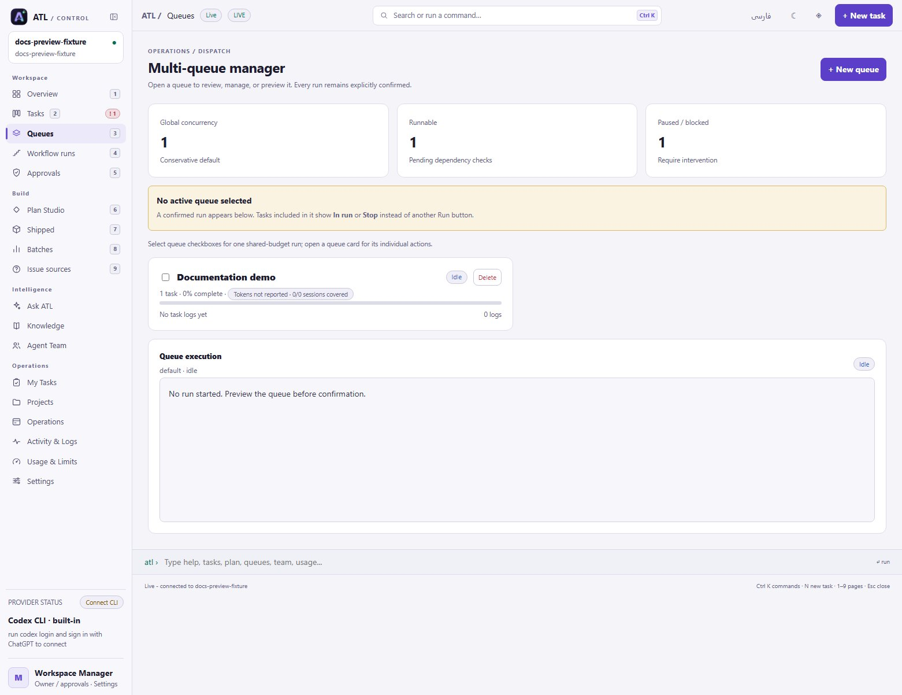
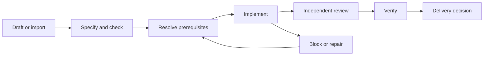

# Tasks and queues

A task defines a bounded outcome and acceptance evidence. A queue chooses the work considered by a bounded run. Order does not remove prerequisite or approval gates.

The **Tasks** board shows active work. Open completed work from **Shipped** to browse its Activity, Changes, and Process, then use **Back to Shipped** to return to the archive. Filters and live status updates clear board selections that are no longer visible.

## Create a task contract

1. Open **Tasks** and create or import work.
2. Define an objective and observable completion checks.
3. Set priority and risk, attach resources, and identify prerequisites.
4. Review the route, worker readiness, and required approval.
5. Resolve incomplete contracts before execution.

A useful check names behavior and a verifier: “Submitting an empty email displays validation and sends no request; run the form regression test.” “Fix the page” does not define acceptance.

## Build a queue

Open **Queues**, create/select a named queue, add reviewed tasks, and inspect its policy and dependencies. Queue membership persists independently of browser selection.

## Test evidence for workflow runs

Define an observable completion check for each scenario. A manager can register a Node verifier for that exact check. ATL runs registered verifiers in the task workspace when the task reaches verification, without a provider session.

```text
atl verifier T-001 "The report is generated" integration verification/report.mjs
atl verification-policy project block
atl verification-policy T-001 inherit
atl test-evidence T-001
```

Verifier types are `unit`, `integration`, `browser`, `e2e`, and `artifact`. A browser verifier writes `before.png` and `after.png` to the directory provided in `ATL_TEST_EVIDENCE_DIR`. Use the same fixture and viewport for the interaction pair. When the verifier is registered before implementation, ATL also attempts a browser baseline before the first implementation session and lists it separately. Test assertions and the process exit determine pass or fail. The Test Evidence panel links the saved output and screenshots under each attempt.

Set the project default under **Settings → Workflow verification**. Each task can inherit the project setting, block completion, or allow completion with evidence gaps. ATL records the policy used for each run. An allowed gap leaves the evidence report unverified. Independent review, verified handoffs, and integrated delivery still use their existing gates.

With automatic model routing enabled, ATL uses the configured capability tiers and cost ordering for unresolved verification work. An inconclusive Beacon session can use one higher-tier route within the existing model ceiling and session budget. Registered tests run independently of model usage.

Replay the local workflow and inspect the before-and-after screenshots, output, and exact results in `.atl-evidence/workflow-verification/index.html`.

```text
node verification/workflow_verification_e2e_test.mjs
node verification/full_e2e_playwright_test.mjs
node verification/e2e/full_operation_test.mjs
```



```sh
atl queue list
atl queue add T-001
atl queue remove T-001
atl launch --dry-run
```

Use your actual task IDs. The top-level CLI exposes add/remove/list/clear. Named-queue commands belong to the browser or terminal command console; see the [console reference](cli-reference.md#browser-and-terminal-command-console).

For example, enter these inside the console, without an `atl` prefix:

```text
queue create nightly --name "Nightly verification"
queue use nightly
queue add T-001
queue inspect nightly
queue dry-run nightly
```

## Read the lifecycle



This conceptual workflow is not the literal status enumeration. Exact values and actor permissions live in `config/manager-state-contract.json`; see [resource model](resource-model.md).

## Diagnose readiness

Use `atl why T-001`, `atl show T-001`, and task evidence/relationships. Missing handoffs, failed checks, unavailable providers, and incomplete approvals must remain visible. See [overnight runs](overnight-runs.md), [queue recovery](queue-recovery.md), and [change review](task-change-review.md).

## Task workspace

In the browser Control Plane the Tasks page is a two-column workspace: a searchable list with All / Running / Needs attention / Completed filters on the left, and the selected task on the right with **Activity** (recorded stages and attempts from the execution projection), **Changes** (the embedded change review), and **Process**, which switches between **Execution** (repository → stages → changed files → checks) and **Impact** — a zoomable "Code impact" graph of repository → stages → changed files with zoom, fit, export, and list views. Ask ATL stays available as a bottom composer; approvals, blocker recovery and browser approval appear inline only when a decision is needed. Acceptance criteria, full specification, task properties, browser configuration, resources and tokens, raw logs and lifecycle history live in collapsed disclosures. Selection, view, scroll and disclosure state survive reloads; below 960px one pane shows at a time with Back navigation. See [change review](task-change-review.md) for the inspection contract.

Completed tasks leave the board to the **Shipped** archive, and every plan chain appears as checked steps on the **Workflow runs** page — per-task role ladder, evidence, and gates.

Source: `runtime/lib/state.mjs`, `queue.mjs`, `launch.mjs`, `dispatcher.mjs`. Checks: `verification/task_dependency_contract_test.mjs`, `supervisor_runner_test.mjs`, `overnight_issue_e2e_test.mjs`, `verification/task_ui_workspace_test.mjs`, `verification/execution_projection_test.mjs`.
