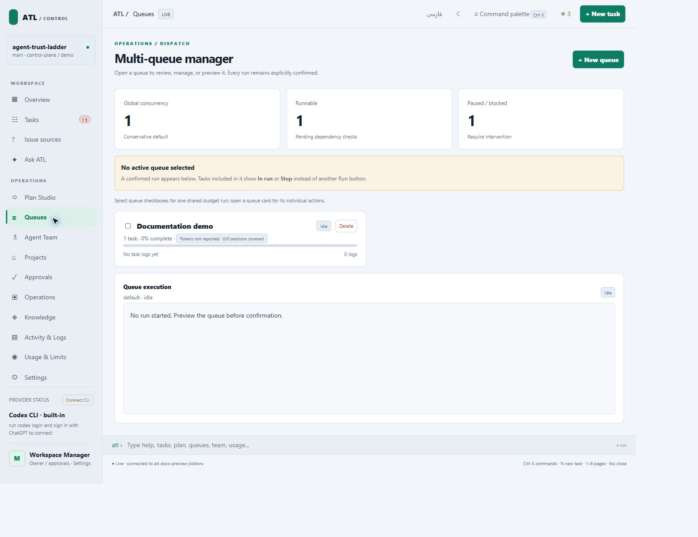
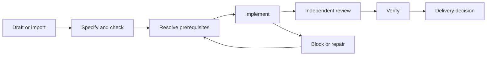

# Tasks and queues

A task defines a bounded outcome and acceptance evidence. A queue chooses the work considered by a bounded run. Order does not remove prerequisite or approval gates.

## Create a task contract

1. Open **Tasks** and create or import work.
2. Define an objective and observable completion checks.
3. Set priority and risk, attach resources, and identify prerequisites.
4. Review the route, worker readiness, and required approval.
5. Resolve incomplete contracts before execution.

A useful check names behavior and a verifier: “Submitting an empty email displays validation and sends no request; run the form regression test.” “Fix the page” does not define acceptance.

## Build a queue

Open **Queues**, create/select a named queue, add reviewed tasks, and inspect its policy and dependencies. Queue membership persists independently of browser selection.



```sh
atl queue list
atl queue add T-001
atl queue remove T-001
atl launch --dry-run
```

Use your actual task IDs. The top-level CLI exposes add/remove/list/clear. Named-queue commands belong to the browser or terminal command console; see the [console reference](cli-reference.md#browser-and-terminal-command-console).

For example, enter these inside the console, without an `atl` prefix:

```text
queue create nightly --name "Nightly verification"
queue use nightly
queue add T-001
queue inspect nightly
queue dry-run nightly
```

## Read the lifecycle



This conceptual workflow is not the literal status enumeration. Exact values and actor permissions live in `config/manager-state-contract.json`; see [resource model](resource-model.md).

## Diagnose readiness

Use `atl why T-001`, `atl show T-001`, and task evidence/relationships. Missing handoffs, failed checks, unavailable providers, and incomplete approvals must remain visible. See [overnight runs](overnight-runs.md), [queue recovery](queue-recovery.md), and [change review](task-change-review.md).

Source: `runtime/lib/state.mjs`, `queue.mjs`, `launch.mjs`, `dispatcher.mjs`. Checks: `verification/task_dependency_contract_test.mjs`, `supervisor_runner_test.mjs`, `overnight_issue_e2e_test.mjs`.
