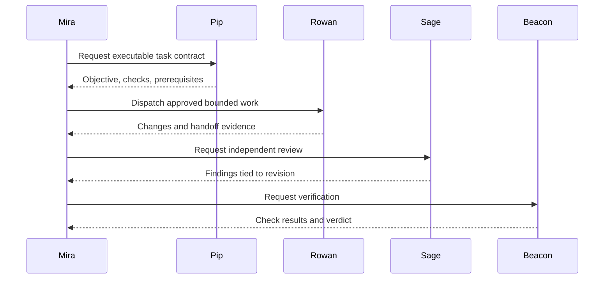

# Agent team

ATL separates coordination, task definition, implementation, review, and verification. Roles define responsibilities; provider configuration chooses the worker/model.

## Know the roles

| Role | Job | Contract |
|---|---|---|
| Mira | Coordinate tasks, gates, and routing | `runtime/prompts/mira.md` |
| Pip | Triage and repair task contracts | `runtime/prompts/pip.md` |
| Rowan | Implement bounded work and integration repairs | `runtime/prompts/rowan.md` |
| Sage | Independently review changes | `runtime/prompts/sage.md` |
| Beacon | Verify current checks and completion evidence | `runtime/prompts/beacon.md` |

Exact transition authority lives in `config/manager-state-contract.json`. A UI label does not override it.

## Inspect the team

Open **Agent Team**, then follow **Activity & Logs**. Inspect task evidence rather than accepting conversational progress as a completion verdict.

```sh
atl role mira
atl feed --n 20 --roster
```

## Follow the handoff



A later edit can invalidate prior review. Missing prerequisite artifacts must block work rather than be invented by the next worker.

## Choose models for roles

Inspect provider readiness, role routing, and eligible model tiers in Settings and launch preview. See [resource policy](resource-policy.md), [queue recovery](queue-recovery.md), and the [resource model](resource-model.md). Mock tests establish routing constraints, not the real-world intelligence of every model.
