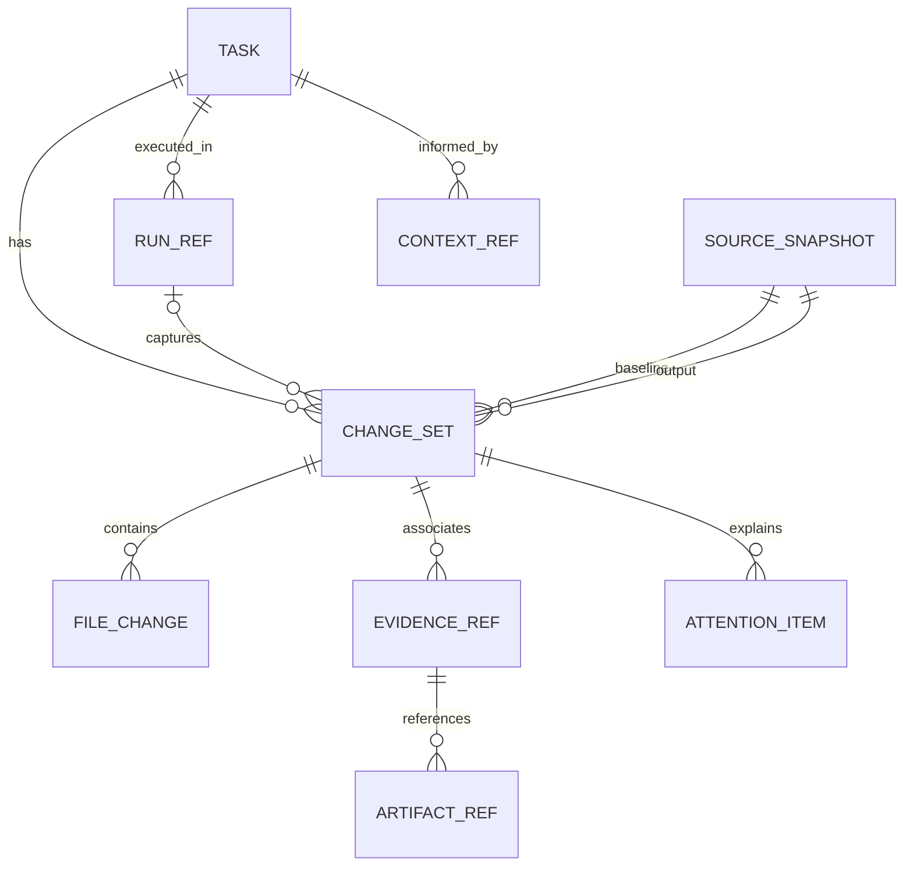

# Task change review: revision-linked model, files, diffs, and attention

Date: 2026-10-27
Status: core implementation present on 2026-10-27; focused/regression checks passed; rendered browser verification remains open. GitHub issue not published.
Suggested issue title: `Add revision-linked task change review with file tree, diffs, evidence, and morning attention`
Target: `depie99/Agent-Trust-Ladder`
Priority recommendation: P1, after current execution/recovery correctness work. No new autonomous authority.

## Implementation evidence — 2026-10-27

- T1–T5: implemented. See `docs/task-change-review.md` for the actual contracts, capture limits, missing states and operator workflow.
- T6: documentation and automated validation complete. The new model, capture-store, API and controller suites passed, together with existing dependency, queue recovery/delivery, Control Plane server/contract, run-control and CSS checks. UI controller coverage uses a DOM double.
- T6 rendered gate: OPEN. Chrome integration failed to connect; diagnostics reported missing extension/native-host setup. Responsive, theme, native keyboard and Persian browser observations were not obtained. No visual/accessibility pass is claimed.
- T7: deferred as planned; no automatic digest/scheduler introduced.
- No GitHub issue, commit, branch or push was performed by this implementation session. The repository received concurrent commits during the work; existing changes were preserved and validation used the current working tree.

The sections below retain the original proposal and research context. The implementation documentation describes shipped behavior and current limitations.

## Decision and phase fit

Build a small read-only task review surface in the current Control Plane phase. The operator needs to answer what actually changed, where it changed, which revision was checked, and what still needs attention. The pictured lifecycle explanation cannot answer those questions. Specs 014 and 017 already put inspectable evidence and review in the operator workflow; Spec 019 makes contextual knowledge advisory. This proposal fills that inspection gap without expanding the Brain or changing task gates.

Necessary now: a trustworthy change manifest, directories/files, a bounded unified diff, revision-matched evidence, and explicit unavailable/stale states. A compact clickable relationship view is useful as a secondary tab. Defer a global graph, semantic dependency engine, built-in editor, new autonomous merge mode, and elaborate review analytics. An overnight digest can follow the first task review slice.

Conditional request assessment: the overnight audit practice is documented in Lauren Tan's pstack, and she describes reviewing work after agents land it. Her exact proposed interactive interface and a personal second-brain graph for overnight code review are NOT established. If the condition means the identical interface must already be in her use, it is unmet; do not present this as a verified reproduction of her tooling. The implementation is an ATL design derived from an established review need.

## Research and attribution

Sources checked on 2026-10-27. Primary upstream files are mutable `main` references; pin their commit revision when implementation begins if they become enduring design evidence.

1. [pstack overnight guide](https://github.com/cursor/plugins/blob/main/pstack/docs/guide/07-overnight.md): documents morning review of a decision trail, evidence pointers, independent scrutiny, an attention list, and before/after proof at automation handoffs. This establishes the practice, not an interactive file explorer or Lauren's private deployment configuration.
2. [show-me-your-work source](https://github.com/cursor/plugins/blob/main/pstack/skills/show-me-your-work/SKILL.md): defines time, phase, decision, why, evidence and result; evidence can identify commits, PRs, file locations, screenshots or traces. It calls for transcript checking, independent review, and spot checks of evidence. This is a useful model for review navigation. It is research material here; this skill was not executed.
3. [Benny README](https://github.com/cursor/plugins/blob/main/pstack/automations/benny/README.md): the published pack separates Slack report triage from confirmed-bug reproduction and possible small draft fixes. The pack is dormant setup material, not proof that all deployments are enabled or reliable. Reuse the separation of report, reproduction, fix and evidence.
4. [Lauren's post](https://x.com/poteto/status/2087244771849089270), reproduced as an embedded post in [ThoughtfulBits' source guide](https://thoughtfulbits.ai/how-to-be-like-poteto): she describes reviewing what agents landed on main while away/asleep. The direct post returned HTTP 403 during this research; this personal-use claim therefore has secondary/embedded corroboration, not a direct authenticated observation.
5. The second-brain question remains unverified: no primary source inspected establishes a specific personal knowledge graph as her overnight code-review interface. ATL's own `research/` and Spec 019 must not be attributed to Lauren's private system.

Adopt evidence-first catch-up and selective drill-down. Do not infer automatic-merge permission, production reliability, or the necessity of a graph from throughput claims.

## Observed repository baseline

Inspection used the current working tree, including existing uncommitted work. Recheck before implementation; do not replace those changes wholesale.

| Existing file | Relevant behavior / gap |
|---|---|
| `runtime/control-plane-client.js` | `taskDetail`, `taskDiagrams`, and `taskUnderstand` expose narrative/static relationships and Mermaid text; no task-scoped patch explorer. `taskUnderstand` currently constructs generic story steps. |
| `runtime/lib/handoffs.mjs` | `snapshot`, `startBaseline`, `recordHandoff`, `readHandoff` already store content-addressed source blobs, baseline/output manifests, modes, changed paths, input revisions and evidence. Completed handoff validation is stricter than preview availability. |
| `runtime/lib/launch.mjs` | Captures a baseline through `startBaseline`, writes session logs, and records completed handoffs. It is the lifecycle integration point for any additional revision capture. |
| `runtime/lib/workspace.mjs` | Creates isolated workspaces, including dirty-source snapshot worktrees. Diffing repository HEAD would wrongly attribute pre-existing changes to a task. |
| `runtime/lib/state.mjs` | Owns lifecycle state, evidence, workspace references and state concurrency. Preserve its authority. |
| `runtime/lib/control-plane.mjs` | Builds Control Plane snapshots. Keep patches out of periodic snapshots. |
| `runtime/lib/control-plane-server.mjs` | Serves `/api/snapshot`, `/api/events`, recovery and delivery endpoints. SSE snapshots run every two seconds; do not add filesystem hashing or patch generation to that loop. |
| `runtime/lib/delivery.mjs` | Persists delivery packets and revision-linked evidence. Reuse those links rather than deriving delivery from task status. |
| `.trust/specs/019-evidence-linked-second-brain/spec.md` | Sources/claims/context are advisory and cannot satisfy evidence or approvals. |

## Observable product behavior

Open a task and choose **Review changes**. Default to the latest captured revision, with task status, capture time, baseline/output revision, source availability, and evidence freshness visible above the content.

- Overview: concise recorded outcome, changed-file count, aggregate additions/deletions where known, and attention reasons. Keep blocked status visible even when some checks passed. Show unknown counts as unknown.
- Files: expandable directory tree with add/modify/delete/mode badges, path search and change-type filters. Selecting a file loads its unified diff. Preserve selection, expanded folders and scroll position across refresh.
- Evidence: checks, review, browser observations and artifacts grouped by exact output revision and packet revision. Distinguish pass, fail, incomplete, invalidated, missing and stale. Passing checks are not a completion or delivery verdict.
- Relationships: a small keyboard-operable SVG/HTML view generated from actual record IDs; selecting a task, run, change set, file or evidence item opens its inspector. Show missing links as missing. Offer the same relationships as an accessible table. No graph-layout library is needed for this bounded hierarchy.
- Decisions: show existing structured records where available. Do not invent a decision log from generic activity text. Label unsupported decision data as unavailable; a new decision-capture system is follow-up scope.
- Long text and mixed Persian/English content use the existing localization and bidi conventions. Source code and paths stay LTR in isolated blocks.

Suggested arrangement:

```text
T-022  Blocked   Captured 07:10   baseline ... -> output ...
Attention: 1 blocker | 2 checks for an older revision
[Overview] [Files] [Evidence] [Relationships]
Files                          Selected path / unified diff
v runtime/                     - previous line
  M control-plane-client.js    + changed line
v verification/                [Evidence for this revision]
  A task_changes_test.mjs      Beacon: missing | Sage: stale
```

## Data model

Use a versioned read model composed from authoritative records. Do not add a second task state machine. The following are proposed contracts, not claims about current schemas.



| Entity | Fields and invariant |
|---|---|
| TaskRef | `task_id`, `packet_revision`, authoritative lifecycle status, objective and owner references. Never infer status from diff/evidence counts. |
| RunRef | Stable ID derived from the actual session/run record, `task_id`, attempt, role, timestamps, outcome and log reference. Nullable when legacy data cannot establish a run. |
| SourceSnapshot | Existing content `revision`, `files[path]=blob_hash`, `modes[path]`. These revisions are SHA-256 content identifiers, NOT Git commit SHAs. Git base/head metadata is optional and separately named. |
| ChangeSet | `version`, deterministic `id`, `task_id`, nullable `run_id`, `packet_revision`, baseline/output content revisions, `input_revisions`, `captured_at`, `source_kind`, `availability`, `files[]`, aggregate completeness. Identity includes task, packet, baseline and output. |
| FileChange | Stable ID, normalized relative `path`, optional `old_path`, kind `added/modified/deleted/mode_changed`, before/after blob hashes and modes, nullable line counts, binary/size flags and patch availability. Rename inference is optional later; preserve add/delete truth now. |
| EvidenceRef | Existing evidence ID or deterministic reference, actor, kind, result, coverage, invalidated flag, packet/code revision, timestamp and artifact refs. Matching is explicit; missing revision cannot imply current. |
| ArtifactRef | Existing record reference, kind, task/run/revision provenance where present, content type, safe local reference or validated external URI, availability. Never accept arbitrary filesystem paths from the browser. |
| AttentionItem | Deterministic rule code, severity, reason, associated record IDs and safe inspection target. Examples: blocked task, failed/incomplete check, missing baseline, stale evidence, unavailable artifact, unreviewed captured revision. No synthetic LLM assurance score. |
| ContextRef | Existing source/claim/context-pack IDs and source revisions with advisory status. Never an evidence or approval substitute. |
| DirectoryNode | Derived parent/child path aggregation and counts; not a persisted entity or ownership assertion. |

An evidence-to-file relationship exists only when a recorded file pointer establishes it. A task-level test result may be shown alongside a file without claiming it specifically covers that file. Imported predecessor outputs remain distinguishable through `input_revisions`; do not claim every composed change was authored by the selected worker.

## Capture, storage and API contracts

1. Compare the task's captured baseline with its captured output, including uncommitted/untracked source and mode-only changes. Do not run `git diff HEAD` and call it the task diff.
2. Reuse validated handoff manifests/blobs for completed tasks. Existing `readHandoff` requires completed verification; previews for blocked/in-progress tasks must use a separate inspection path and must not relax that validator.
3. Prefer an explicitly requested capture for live work. Capture may publish a local immutable inspection manifest but cannot mark a task done, approve a handoff or run a provider. Use a CSRF-protected POST for capture; GET endpoints must not create snapshots/blobs. Detect concurrent source changes during capture and report retry/inconsistent rather than claiming an atomic revision. Do not change existing handoff revision semantics to implement this.
4. Proposed inspection records: `.trust/manager/change-reviews/<task-id>/<change-set-id>.json`. Reuse existing `.trust/manager/handoffs/blobs/<digest>` through a validated helper. Write blobs before atomic manifest publication; do not embed patches in state or SSE. Legacy tasks with no baseline remain `baseline_missing`; never fabricate the baseline from current HEAD.
5. `GET /api/task-changes?taskId=...&changeSetId=...&cursor=...&limit=...` returns revision metadata and paginated file metadata. Resolve every identifier server-side to the task's records.
6. `GET /api/task-change-diff?taskId=...&changeSetId=...&fileId=...` returns bounded escaped text hunks and completeness metadata. No free-form workspace or file path query.
7. `POST /api/task-changes/capture` accepts only `task_id`; use existing owner-session/CSRF checks and return a pinned inspection record. A separate capture is not needed for an available completed handoff.
8. Validate containment, hashes and expected task associations; reject traversal, symlink escapes, foreign record IDs and corrupt blobs. Handle unavailable workspaces and archives explicitly. Do not execute external diff/textconv drivers or interpolate paths into shell commands. Diff stored bytes with a bounded algorithm or a safely isolated tool invocation.
9. Set hard request/file/hunk/time limits, mark truncated output, and suppress binary patches. Proposed defaults: 100 file rows/page, 1 MiB text per side, 256 KiB patch response and 5-second diff budget. Tune from fixtures, not assumptions. Credential/config content must follow an explicit exclusion/redaction policy; when redacted show that fact and exclude it from completeness claims. Do not alter source hashes for presentation redaction.
10. Old captured output stays inspectable when live work advances. Label it historical and display checks for its exact revision. No polling-triggered rescan or silent patch replacement while the operator reads.

## Implementation tasks and exact file guide

New paths below are proposals. Existing paths were inspected. Do not introduce all optional work into the first slice.

| Task | Files | Outcome / verification |
|---|---|---|
| T1: pin schema and fixture cases | New `docs/task-change-review.md`; new `verification/fixtures/task-changes/` | Document the contracts above, exact missing/error states, exclusions and response bounds. Fixtures include dirty inherited baseline, imported predecessor files, mode-only edit, deletion, binary, unicode and legacy task. Review schema before coding. |
| T2: implement pure manifest comparison and bounded diff | New `runtime/lib/task-changes.mjs`; new `verification/task_changes_test.mjs`; narrow helper extraction in `runtime/lib/handoffs.mjs` only if needed | Deterministic change IDs; verify hashes on both sides including deleted files' baseline blobs; mode-only detection, no cross-task reads, explicit corruption/unavailable states. Verify `node verification/task_changes_test.mjs` and `node verification/task_dependency_contract_test.mjs`. |
| T3: capture and retain inspection revisions | New `runtime/lib/change-review-store.mjs`; new `verification/change_review_store_test.mjs`; optional narrow `runtime/lib/launch.mjs` hook after inspecting its lifecycle | Atomic publication, idempotent repeated capture, distinguish run/packet revisions, detect concurrent capture changes, recovery after incomplete write. Reuse completed handoffs without changing their gates. Prefer manual capture first; automatic capture is optional after its cost is measured. Verify `node verification/change_review_store_test.mjs` and `node verification/queue_recovery_delivery_test.mjs`. |
| T4: serve safe lazy read endpoints | `runtime/lib/control-plane-server.mjs`; `runtime/lib/control-plane.mjs` only for lightweight refs; new `verification/task_changes_api_test.mjs` | Add three endpoints above using existing origin/owner checks. Ensure SSE contains neither patches nor new hashing. Verify `node verification/task_changes_api_test.mjs`, `node verification/control_plane_server_test.mjs`, and `node verification/control_plane_contract_test.mjs`. |
| T5: ship review UI and bounded relationship view | `runtime/control-plane-client.js`, `runtime/control-plane.html`, `runtime/control-plane-i18n.js`, `runtime/scss/_app.scss`; regenerate the inlined stylesheet in `runtime/control-plane.html` using `npm run ui:css` | Add task action and tabs, tree/diff inspector, freshness badges, missing states, real record links and keyboard/table fallback. Preserve task story as overview but remove unsupported assertions of completed work. Avoid hard-coded five-step success narratives. Verify new `node verification/task_changes_ui_test.mjs`, `node verification/control_plane_fa_queue_test.mjs`, and `npm run ui:css:check`; use `npm run ui:css` to regenerate first if SCSS changes. The inspected `scripts/build-control-plane-css.mjs` compiles SCSS directly into the HTML style block; there is no separate generated runtime CSS file. |
| T6: document and observe end to end | `docs/task-change-review.md`, `USAGE.md`, `verification/README.md`; extend `verification/run_control_plane_test.mjs` only where its harness fits | Walk task -> changed directory -> file -> diff -> exact revision evidence. Show blocked, stale, absent workspace and archived artifact cases. Validate rendered dark/light, narrow viewport, keyboard focus, refresh and Persian paths using the supported browser workflow. Run `node verification/run_control_plane_test.mjs` and all new tests above. Record actual outcomes, not assumed passes. |
| T7: optional morning catch-up after T1-T6 | New `runtime/lib/change-review-digest.mjs`, new `verification/change_review_digest_test.mjs`, narrow UI additions in `runtime/control-plane-client.js` | Group captured work since an explicit time/run boundary, lead with deterministic attention items, link to pinned task revisions. Do not mark viewing as approval. Verify `node verification/change_review_digest_test.mjs`; no scheduler or external message required. |

Implementation order: T1 -> T2 -> T3 -> T4 -> T5 -> T6. T7 is a follow-up. Each new verifier is to be created with its task; none of these new test files or results exists yet.

Files at regression risk even if unchanged: `runtime/lib/state.mjs`, `workspace.mjs`, `delivery.mjs`, `launch.mjs`, `session-auth.mjs`, `brain.mjs`, `dashboard.mjs` (shared snapshot consumers), and existing handoff/dependency/recovery tests. Preserve lifecycle status, exact-revision delivery checks, content-hash identities, credential boundaries and Brain advisory behavior.

## Acceptance examples

- A workspace starts with an unrelated dirty edit. The worker changes another file. Review shows only the difference from the captured task baseline; existing dirt is not attributed to the worker.
- The worker changes a file again after verification. The old captured patch remains stable; its evidence is labeled for that captured revision, and a new capture shows stale/missing verification.
- A task is blocked with two passing checks. Review shows blocked and its reason; it does not display successful delivery.
- A completed handoff has no remaining workspace. Available manifests/blobs still support historical review; absent or corrupt artifacts are visibly unavailable/corrupt.
- A legacy task has no baseline. The interface explains that the task diff cannot be reconstructed; it does not show zero changes or use current HEAD as a substitute.
- Added, deleted, binary, mode-only, large and Persian-named files have correct labels. Binary and oversized changes have explicit bounded previews; rename inference is not required.
- A file ID from another task, `../`, an absolute path, a symlink escape or a corrupt blob cannot expose content. Redaction is explicit and cannot produce a complete-review badge.
- Every relationship node maps to a real ID, every selectable file opens the same pinned change set, and every evidence badge reports its actual revision coverage. Task-level evidence is not advertised as per-file proof.
- With a fixture of 1,000 changed paths, metadata is paginated, opening one file requests only that patch, and a normal SSE update generates no patch or filesystem snapshot. Measure on the documented machine; target cached first metadata under 500 ms and bounded patch work under five seconds, with timeout visible.
- A capture interrupted before manifest publication leaves no partially valid record. A repeated capture of unchanged source is idempotent; concurrent source changes yield explicit retry/inconsistency.

## Pre-mortem, rollout and rollback

1. Wrong task attribution or stale evidence appears trustworthy. Detect with inherited-dirt, predecessor and revision-mismatch fixtures. Contain by hiding the verdict and reporting unavailable; retain authoritative source records.
2. Source inspection leaks content or freezes the service. Detect with traversal/symlink/credential/large-binary fixtures and request bounds. Contain by disabling inspection routes/action while task execution and existing detail views continue.
3. Snapshot capture changes handoff identity, blocks completion or grows storage without bounds. Detect with existing dependency/recovery delivery tests plus interrupted-write/replay fixtures. Keep inspection manifests separate; disable new capture hooks without deleting handoff blobs. Define retention before automatic captures; no garbage collection of shared blobs in this slice.

Roll out behind an additive UI capability flag or equivalent server capability response. Start with completed handoffs, then explicit live captures, then optional digest. No migration is required for legacy tasks; missing data stays missing. Rollback disables the action/routes and leaves immutable records available for later inspection. No branch, commit, push, merge, dependency installation or external communication is part of implementation authority conferred by this proposal.

## Planning evidence and publication gate

This plan is based on static repository inspection and published research, not runtime verification of a newly implemented feature. No product source was changed and no implementation tests were claimed to pass. The repository already has extensive unrelated modifications; implementation must rebase its assumptions on the working tree at that time.

GitHub publication was attempted through capability discovery: `gh issue list` reported no authenticated CLI session; Chrome connection and its documented retry failed. No issue was created, and duplicate issue search remains open. Once authenticated access is available, search existing issues for task changes/diff/review, then publish this body if the user's conditional threshold is accepted. If using the browser, obtain the required action-time confirmation immediately before submitting the issue.
