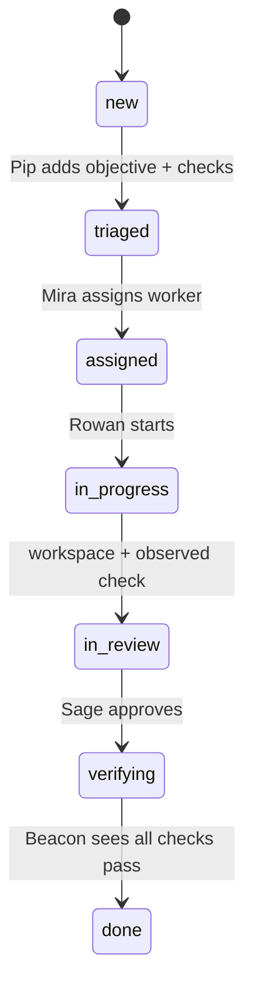

# ATL formal verification suite

Read [development](../docs/development.md) for setup and the [feature map](../docs/guides.md) for executable regression entry points. This page retains formal-model procedures and their limits.

Task change review: run `node verification/task_changes_test.mjs`, `node verification/change_review_store_test.mjs`, `node verification/task_changes_api_test.mjs`, and `node verification/task_changes_ui_test.mjs`. These cover baseline attribution, immutable captures, lazy/pinned previews, revision freshness, bounds, redaction, corruption and controller state. The UI test uses a DOM double; rendered/accessibility checks remain separate. See [task change review](../docs/task-change-review.md) for the isolated fixture and known validation limits.

The executable queue recovery and delivery regression is documented in [queue preparation and delivery](../docs/queue-recovery.md). Run `node verification/queue_recovery_delivery_test.mjs` to exercise verified handoffs, offline prerequisites, bounded repair, restart replay, and the integrated browser delivery gate using deterministic local providers.

`atl_lifecycle_model.py` is a small exhaustive reference model for the route gates in the canonical ATL router. It checks that verification evidence exists before a route can reach `trusted`. It is intentionally not a proof of product correctness or of any particular agent's behavior.

Run the baseline and the negative control:

```text
python verification/atl_lifecycle_model.py
python verification/atl_lifecycle_model.py --mutation-test
```

The mutation test injects an unsafe `implemented → verified` transition without evidence and requires the invariant checker to reject it. If the lifecycle contract changes, update the model and this mapping together, then rerun both commands.

## Manager state gates

`config/manager-state-contract.json` is the canonical machine-readable contract for manager statuses, transition actors, and evidence requirements. `runtime/lib/state.mjs` consumes that file directly; `atl_manager_lifecycle_model.py` checks that its explicit modeling assumptions still match it before exploring states:



Run its baseline and negative control:

```text
python verification/atl_manager_lifecycle_model.py
python verification/atl_manager_lifecycle_model.py --mutation-test
```

The project-local `verify-atl-manager-lifecycle` skill documents the mapping, bounds, counterexample meaning, and drift trigger for the next agent.

If the contract changes, the model exits with `MODEL ERROR: CONTRACT DRIFT` until its assumptions and this skill are reviewed together. This catches model/contract drift; runtime behavior inside the requirement checks still needs the normal JavaScript validation and review gates.

## Maintaining the verification skill

Run the project-local maintenance loop after changing a model, contract, verification skill, or packaging path:

```text
python scripts/maintain_verification_skill.py
```

It checks the cold-agent skill assets and runs both baseline and mutation checks for the abstract ATL lifecycle and concrete manager lifecycle. This is infrastructure health evidence, not proof of the whole product.

The Jev route test also proves the decision boundary: high-confidence choices may be accepted, while low-confidence choices fall back to deterministic routing.
